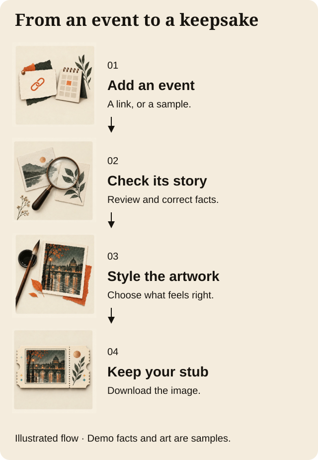
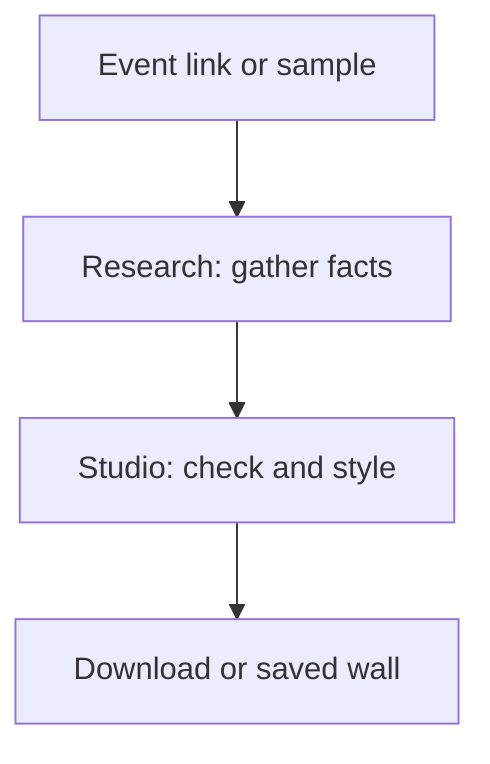

# TicketStub · Keep the night

**Turn an event link into a ticket stub you can keep, change, and share.**


*AI illustration of the idea, not a product photo or proof of printing.*

**[Demo placeholder & status](docs/judges/DEMO.md) · [Open the product](https://getticketstub.com/) · [See the evidence](docs/judges/EVIDENCE.md) · [Browse the code](REPOSITORIES.md)**

> **Before judging:** A final demo video, required quote-post, and form confirmation are not yet in this evidence pack. A full live journey still needs proof. [Submission checklist →](docs/judges/RULES-CHECKLIST.md)

## A ticket should hold more than a barcode

A great night can leave you with a link buried in an inbox. TicketStub aims to keep the story: the place, the date, the weather, and what made that night yours.

Check the facts and turn them into art you can edit. This is a hackathon prototype, not a finished print shop.

## One night, one keepsake

Imagine a fan who wants to remember a show. Our clearest repeatable example uses **The Pale Hours**, a fictional band in Glasgow.

1. **Give it an event.** Choose the sample concert. The live path also accepts an event link.
2. **Check the story.** The demo loads sample facts: night two of three, rain, and an unsure date. You choose the date you mean.
3. **Shape the result.** The demo agent uses rules to explain the stub. Choose a style and keep the details you want.
4. **Keep it.** Download the image or pin the stub to your local wall.

We replayed the sample, saved its PNG, and checked its wall on October 12. The sample facts, art, and agent replies are simulated. This proves the demo flow, not live research. It is a use case, not a customer testimonial.


*Real app screenshot from a local demo; no paid model or printer was used.*

<details>
<summary><strong>See the four-step journey</strong></summary>



*Concept illustrations explain the flow; the screen above shows the actual product.*

</details>

## How it works



*The local demo supplies sample facts and art; separate live-run evidence is linked below.*

## The three required tools

| Tool | Job | Proof and limits |
| --- | --- | --- |
| neatlogs | Show the steps in an agent run. | [Trace screenshots](docs/judges/EVIDENCE.md#neatlogs): live runs reported; exact code binding unverified. |
| Entire | Map the code and record coding context. | [Public code graph](docs/judges/EVIDENCE.md#entire); checkpoint contents stay private. |
| cfo.ai | Plan prices, costs, and funding. | [Business plan and workbook](docs/judges/EVIDENCE.md#cfoai); forecasts, not sales. |

## What you can judge today

The local demo makes an editable stub and downloads an image. The evidence pack also holds research and art trace screenshots, code graphs, and a business plan.

Still unproven: one complete live agent journey and measured improvement across comparable runs. Physical orders are previews. Our demo uses sample data. [System map and claim limits →](docs/judges/EVIDENCE.md)

## Try the sample

In a fresh clone, use the studio’s [Node and npm versions](repositories/getticketstub.com/package.json):

```sh
cd repositories/getticketstub.com
npm ci
TICKETSTUB_RUNTIME_MODE=demo npm run dev
```

Open the local address printed in the terminal. Choose **The Pale Hours**, confirm its date, and select **Download PNG**. No provider key is needed. [Tested setup →](docs/judges/DEMO.md#replay-the-sample)

## Built by Jevelopers

[Timothy Wayne Gregg](https://github.com/CompleteDotTech) · [Lars van der Zande](https://github.com/lmvdz) · [Zachary Wright](https://github.com/zwright8) · [@lajefahemp-collab](https://github.com/lajefahemp-collab). Brand and studio design: Lars.

[Judge scorecard](docs/judges/EVIDENCE.md#follow-the-scorecard) · [Original commits and dates](docs/judges/EVIDENCE.md#code-history) · [Refresh the collection](docs/judges/SYNC.md)

Original development history stays in the source repos. This collection keeps exact commit links. Its source snapshots may be newer than the tested evidence.
