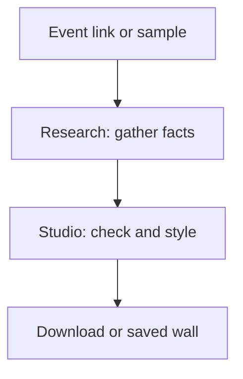

# TicketStub · Keep the night

**Turn an event link into a ticket stub you can keep, change, and share.**


*AI illustration of the idea, not a product photo or proof of printing.*

**[Demo placeholder & status](docs/judges/DEMO.md) · [Open the product](https://getticketstub.com/) · [See the evidence](docs/judges/EVIDENCE.md) · [Browse the code](REPOSITORIES.md)**

> **Before judging:** Our [submission quote-post](https://x.com/CompleteTechLLC/status/2109758479720231135) of the official neatlogs launch is public, with the 2:56 demo video attached. The form confirmation is not yet in this evidence pack, and a full live journey still needs proof. [Submission checklist →](docs/judges/RULES-CHECKLIST.md)

## A ticket should hold more than a barcode

A great night can leave you with a link buried in an inbox. TicketStub aims to keep the story: the place, the date, the weather, and what made that night yours.

Check the facts and turn them into art you can edit. This is a hackathon prototype, not a finished print shop.

## One night, one keepsake

Imagine a fan who wants to remember a show. Our clearest repeatable example uses **The Pale Hours**, a fictional band in Glasgow.

1. **Give it an event.** Choose the sample concert. The live path also accepts an event link.
2. **Check the story.** The demo loads sample facts: night two of three, rain, and an unsure date. You choose the date you mean.
3. **Shape the result.** The demo agent uses rules to explain the stub. Choose a style and keep the details you want.
4. **Keep it.** Download the image or pin the stub to your local wall.

We replayed the sample, saved its PNG, and checked its wall on October 12. The sample facts, art, and agent replies are simulated. This proves the demo flow, not live research. It is a use case, not a customer testimonial.

<picture>
  <source media="(max-width: 600px)" srcset="docs/assets/submission/studio-demo-mobile.jpg">
  
</picture>

*Real app screenshot from a local demo; no paid model or printer was used.*

<details>
<summary><strong>See the four-step journey</strong></summary>


*Concept illustrations explain the flow; the screen above shows the actual product.*

</details>

## How it works



*The local demo supplies sample facts and art; separate live-run evidence is linked below.*

## The three required tools

| Tool | Job | Proof and limits |
| --- | --- | --- |
| neatlogs | Show the steps in an agent run. | [Trace screenshots](docs/judges/EVIDENCE.md#neatlogs): reported live runs; code version unconfirmed. |
| Entire | Map the code and record coding context. | [Public code graph](docs/judges/EVIDENCE.md#entire); coding session notes stay private. |
| cfo.ai | Plan prices, costs, and funding. | [Business plan and workbook](docs/judges/EVIDENCE.md#cfoai); forecasts, not sales. |

## What you can judge today

The local demo makes an editable stub and downloads an image. The evidence pack also holds research and art trace screenshots, code graphs, and a business plan.

Still unproven: one complete live agent journey and measured improvement across comparable runs. Physical orders are previews. Our demo uses sample data. [System map and claim limits →](docs/judges/EVIDENCE.md)

## Try the sample

In a fresh folder, check out the version we replayed. Use its [Node and npm versions](https://github.com/Jevelopers-neatHack-2026/getticketstub.com/blob/6daafba1a3384b20ad181b957fd5d5715da29153/package.json):

```sh
git clone https://github.com/Jevelopers-neatHack-2026/getticketstub.com.git ticketstub-demo
cd ticketstub-demo
git checkout 6daafba1a3384b20ad181b957fd5d5715da29153
npm ci --ignore-scripts
TICKETSTUB_RUNTIME_MODE=demo npm run dev
```

Open the local address printed in the terminal. Choose **The Pale Hours**, confirm its date, and select **Download PNG**. No provider key is needed. [Tested setup →](docs/judges/DEMO.md#replay-the-sample)

## Built in public on X

Every post below is public on [@CompleteTechLLC](https://x.com/CompleteTechLLC). Times are Eastern; counts were read in Chrome on October 12 at 5:45 PM and will change.

| When | Post | What it shows | Engagement |
| --- | --- | --- | --- |
| Oct 10, 9:02 AM | [Team kickoff](https://x.com/CompleteTechLLC/status/2108906067060990141) | Team Jevelopers starts #neatHack2026 and invites people to build alongside us. | 2 likes, 1 repost, 66 views |
| Oct 10, 9:11 PM | [Day 1 build post](https://x.com/CompleteTechLLC/status/2109089580159004778) | Introduces TicketStub with a preview link. | 6 likes, 1 repost, 163 views |
| Oct 11, 6:17 PM | [Day 2 build post](https://x.com/CompleteTechLLC/status/2109407964784382285) | The site goes live, with the stream link and Timothy's usage figures. It quotes Ajay Yadav's October 10 neatlogs post and attaches a video. | 1 like, 170 views |
| Oct 12, 5:08 PM | [Demo video post](https://x.com/CompleteTechLLC/status/2109753079604166718) | The demo video as a standalone post. | 14 views |
| Oct 12, 5:29 PM | [**Submission quote-post**](https://x.com/CompleteTechLLC/status/2109758479720231135) | Quotes the [official launch post](https://x.com/bettersayAJ/status/2109639214723932495) with the demo video and tags @neatlogs, @EntireHQ and @arithecfo. | 1 like, 16 views |

Each post names the hosts or the three required tools. A [text-only Day 2 copy](https://x.com/CompleteTechLLC/status/2109407386289189284) and a [second kickoff copy](https://x.com/CompleteTechLLC/status/2108920181380805025) are also public. Usage and cost figures in the posts are owner reports, not audited metrics. A search of X on October 12 found no event posts from the other team members' accounts. [Building-in-public evidence →](docs/judges/EVIDENCE.md#building-in-public)

## Built by Jevelopers

[Timothy Wayne Gregg](https://github.com/CompleteDotTech) · [Lars van der Zande](https://github.com/lmvdz) · [Zachary Wright](https://github.com/zwright8) · [@lajefahemp-collab](https://github.com/lajefahemp-collab). Brand and studio design: Lars.


[Judge scorecard](docs/judges/EVIDENCE.md#follow-the-scorecard) · [Repo, line, and commit counts](REPOSITORIES.md#collection-at-a-glance) · [Code versions and dates](docs/judges/EVIDENCE.md#code-history) · [Refresh the collection](docs/judges/SYNC.md)

The original commits also live here, with [contributor credit preserved](docs/judges/CONTRIBUTORS.md). Each code copy links to its saved version. Newer copies may go beyond the tested evidence.
