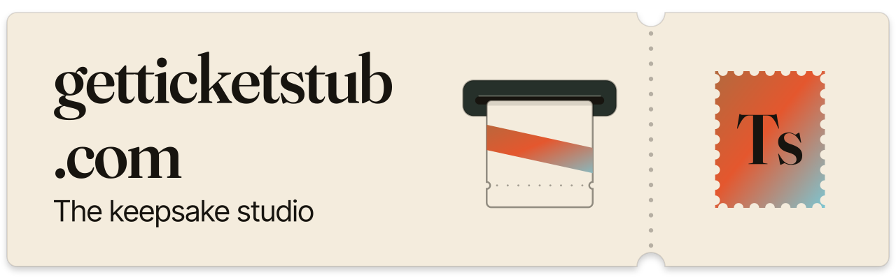

<a href="https://github.com/Jevelopers-neatHack-2026/cost-intelligence">
  <picture>
    <source media="(prefers-color-scheme: dark)" srcset="docs/assets/readme/banner-night.svg">
    
  </picture>
</a>

# cost-intelligence

TypeScript finance package for TicketStub usage pricing, budgets, the financial ledger, reconciliation, summaries and exports.

<p>
  <a href="https://github.com/Jevelopers-neatHack-2026"></a>
  <a href="#status"></a>
  <a href=".node-version"></a>
  <a href="postgres-test-image.json"></a>
</p>

[Status](#status) · [Quickstart](#quickstart) · [Checks](#checks) · [Docs](#docs) · [Related](#related-repositories)

## Status

Implemented locally, exercised with synthetic fixtures against PostgreSQL 16:

- **Pricing v2** — `registerPricingRuleV2`, `registerRateCardV2`, `registerFxRateV2` and `estimateV2`: immutable scoped catalog versions and exact, non-posting estimates through host-injected authority, clock and database ports. See [pricing](docs/api/pricing.md).
- **Financial ledger** — `appendLedgerEvent` and `rebuildLedgerProjection`: append-only PostgreSQL events and deterministic as-of projections. See [ledger](docs/api/ledger.md).

Still typed unavailable: after validation and scope checks, these public methods always return an error result:

| Module | Methods | Error code |
| --- | --- | --- |
| metering | `ingestUsage` | `SOURCE_UNAVAILABLE` |
| pricing (1.0.0) | `estimate` | `PRICING_UNKNOWN` |
| budgets | `authorize`, `markDispatched`, `settle`, `release`, `changeBudget` | `BUDGET_UNAVAILABLE` |
| budgets | `recordExpenseAdjustment` | `SOURCE_UNAVAILABLE` |
| ledger | `ingestFinancial` | `SOURCE_UNAVAILABLE` |
| reporting | `querySummary` | `SOURCE_UNAVAILABLE` |
| reconciliation | `startReconciliation`, `getReconciliation` | `RECONCILIATION_PENDING` |
| integrations | `exportSummary` | `SOURCE_UNAVAILABLE` |

Pending, and not claimed here:

- **Financial acceptance.** The FIN, BUD, DASH-04 and SPN-03 criteria in the [acceptance view](docs/architecture/ACCEPTANCE.md) are all still `planned` in the integration-evals master checklist; none is verified. `test:integration` and `test:release` fail closed until the missing domain suites land ([details](docs/development.md#suite-selectors-and-gates)).
- **Host integration.** Pricing's real Finance issuer adapter and the ledger's external trusted-context handoff are still pending.
- **Shared contracts.** `@jevelopers/shared-contracts@0.3.0` is pinned as a **proposal-only** dependency with unresolved finance findings FC-001 to FC-004 and no accepted consumer handoff. Local use proves the pinned artifact is consumed and checked; it does not make it canonical or release-ready. See [`contracts.lock.json`](contracts.lock.json) and [compatibility](docs/api/compatibility.md).

> [!WARNING]
> This repository is public. Commit only sanitized fixtures and reports; do not add credentials, production records, connection strings, private customer data, or local absolute paths.

## Quickstart

Requires Node.js 22.23.3 and npm 10.9.9 ([`.node-version`](.node-version), `engine-strict`). Database suites also need Docker with a running daemon.

```sh
npm ci
npm run typecheck
npm run build
```

`npm run build` compiles to `dist/` and regenerates the versioned JSON Schemas under [`schemas/`](schemas/) and [`docs/api/schema-index.json`](docs/api/schema-index.json).

## Checks

```sh
npm run test:contracts
npm run test:exports
npm run test:smoke -- --offline
npm run test:traceability
npm run test:pricing -- --offline      # Docker: PostgreSQL 16
npm run test:ledger -- --offline       # Docker: PostgreSQL 16
npm run test:migrations -- --offline   # Docker: PostgreSQL 16
```

`--offline` means no provider or accounting calls; Docker may pull the digest-pinned image. The [development guide](docs/development.md) covers the full suite inventory, the PostgreSQL lifecycle, the `CI_TEST_DATABASE_URL` override, budget selectors (including deferred nested scopes, issues [#17](https://github.com/Jevelopers-neatHack-2026/cost-intelligence/issues/17) and [#18](https://github.com/Jevelopers-neatHack-2026/cost-intelligence/issues/18)) and the packed-consumer check.

## Docs

| Document | Covers |
| --- | --- |
| [Development and verification](docs/development.md) | Toolchain pins, commands, suites, database lifecycle |
| [API notes](docs/api/README.md) | Versions, errors, money, scope, schema artifacts |
| [Pricing](docs/api/pricing.md) · [Ledger](docs/api/ledger.md) | Implemented v2 pricing and ledger behavior |
| [Compatibility](docs/api/compatibility.md) | Shared-contract pin, FC-001 to FC-004, upgrade gate |
| [Ownership](docs/architecture/OWNERSHIP.md) · [Decisions](docs/architecture/DECISIONS.md) · [Acceptance](docs/architecture/ACCEPTANCE.md) | Responsibilities, decisions, acceptance IDs |

## Related repositories

- [shared-contracts](https://github.com/Jevelopers-neatHack-2026/shared-contracts): producer of the pinned proposal schemas
- [team-dashboard](https://github.com/Jevelopers-neatHack-2026/team-dashboard): finance administration module; planned consumer of finance read projections
- [integration-evals](https://github.com/Jevelopers-neatHack-2026/integration-evals): authoritative acceptance checklist and evidence
- [getticketstub.com](https://github.com/Jevelopers-neatHack-2026/getticketstub.com): host application and [central implementation plan](https://github.com/Jevelopers-neatHack-2026/getticketstub.com/blob/main/docs/planning/implementation-plan.md)

## Contributing

Follow the organization [contributor guidance](https://github.com/Jevelopers-neatHack-2026/.github/blob/main/CONTRIBUTING.md). No license file is present in this repository.
