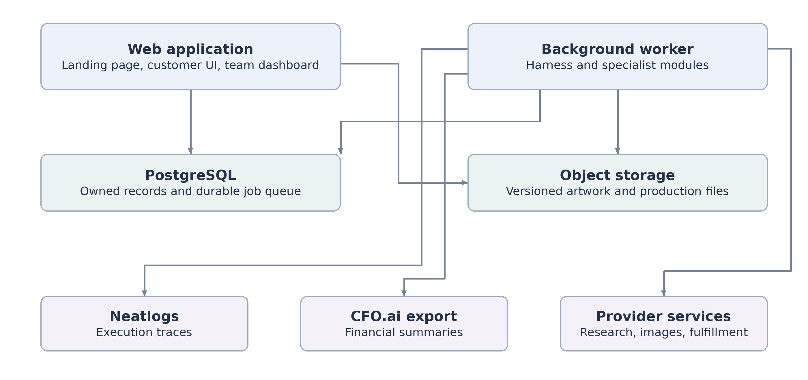

# Jevelopers Repository Architecture

Technical plan for the commemorative ticket platform

Version 1.0 | October 10 2026 | Jevelopers

## 1 Architecture decision

Organize the platform into **14 repositories with clear ownership**, and assemble them into a small, reproducible application. Keep the six existing repository names and add eight repositories for shared contracts, event research, artwork, print production, fulfillment, cost intelligence, the team dashboard, and integration evaluations.

The product turns an event URL into researched facts, original artwork, customer revisions, approved commemorative tickets, downloadable files, and an authorized print order. The same workflow records its resource use and financial outcomes so the team can understand development spending and order profitability.

Repository boundaries define who maintains code. Deployment boundaries define what must run independently. The initial deployment should contain one web application, one background worker, PostgreSQL, and object storage. Specialist modules can execute inside the worker. The dashboard can be developed separately and mounted into the web application through authenticated administrative routes.

### Decisions that guide implementation

- **One owner for each business record.** The customer application owns customer orders and authorizations; the harness owns workflow execution; specialist modules own their domain records; cost intelligence owns financial postings and reports.
- **Shared contracts before parallel implementation.** Agree on a minimal set of requests, events, errors, and fixtures before independently building consumers.
- **Costs recorded from the first working call.** Meter billable attempts, reserve budget before execution, and retain missing or uncertain billing data for reconciliation.
- **A narrow complete demonstration.** Finish one event research and design journey, one revision, a verified export, an authorized sandbox order, and an auditable financial summary.
- **One submission entry point.** Use `getticketstub.com` as the integration and submission hub, with a manifest identifying the exact component revisions used in the demonstration.

### Scope and priorities

P0 identifies the capability needed for the demonstration and its financial integrity. P1 identifies the next useful expansion. Production denotes work required before accepting real customer payments or placing live print orders. These are team priorities. Published competition requirements are recorded separately in section 11.

The target structure preserves independent development without requiring fourteen services, fourteen release pipelines, or a complete commercial platform during the event. A proposed repository can begin with one focused package and a clear interface.

<!-- pagebreak -->

## 2 Repository inventory

The first six repositories retain the supplied names. The eight additions are proposed capabilities. Detailed ownership and module paths appear in the fourteen repository briefs.

| Repository | Core responsibility | First delivery |
| --- | --- | --- |
| `marketing-material` | Demo narrative, launch copy, product examples, evidence references | Storyboard and approved assets |
| `agent-harness` | Planning, tool routing, durable execution, recovery, Neatlogs tracing | Recoverable agent workflow |
| `getticketstub.com` | Customer experience, authentication, orders, integration workspace | Working submission hub |
| `brand-kit` | Visual identity, design tokens, typography, asset permissions | Versioned visual foundation |
| `landing-page-repo` | Public product explanation, examples, conversion | Static product landing page |
| `.github` | Contribution standards, governance sources, reusable CI | Applicable shared standards |
| `shared-contracts` | Versioned schemas, validators, errors, shared fixtures | Minimal compatible interfaces |
| `event-intelligence` | Event facts, source provenance, brand research, safe retrieval | Verified event package |
| `creative-engine` | Creative briefs, image generation, edits, artwork versions | Initial design and revision |
| `print-production` | Deterministic text, personalization, exports, print checks | Validated production bundle |
| `fulfillment-connectors` | Supplier catalog, quotes, submission attempts, tracking | One sandbox adapter |
| `cost-intelligence` | Metering, pricing, budgets, ledger, reconciliation, CFO export | Attributed financial summary |
| `team-dashboard` | Financial and operational views, filters, drilldowns | Team finance overview |
| `integration-evals` | Cross-module scenarios, failure tests, comparisons, evidence | Reproducible complete journey |

### Naming and ownership

Keep `getticketstub.com` as the application repository and use the package alias `storefront` inside the integration workspace. A later product naming decision can change the display name without changing these responsibilities. No rename is required by this plan.

Assign one accountable role and at least one reviewer to every engineering repository. The same contributor may own several repositories. Record actual GitHub handles only after team assignments are agreed.

The landing page, customer application, and dashboard should consume the same versioned brand assets. Production assets must carry their applicable license or permission references. Marketing selects approved outputs; it does not become a second source for application components.

<!-- pagebreak -->

## 3 Runtime and integration boundaries

The customer application is the composition root: it assembles packages, exposes authenticated APIs, serves the landing page and customer interface, and mounts the protected team dashboard. The worker runs the harness and specialist operations. PostgreSQL provides durable records and a job queue for the initial implementation; object storage holds immutable artwork and production files.

Proposed technology defaults are Next.js for the composed web application, ChatKit with a design canvas for customer interaction, and GPT Image for artwork generation and editing. Select exact models, SDKs, and compatible versions during kickoff. Keep providers behind the documented interfaces.

### Responsibilities inside the deployment

**Web application.** Own customer and team authentication, project records, order state, approval screens, downloads, webhook ingress, and server-side authorization. A browser request may propose an action; the server decides whether the actor can perform it.

**Background worker.** Execute bounded jobs through the harness. Keep research, generation, rendering, and supplier adapters behind typed module interfaces. Run reconciliation and export jobs here as well. Move a module to a separate service only when a measured scaling, isolation, or operational need justifies it.

**Persistent data.** Assign each table and migration a module owner. Permit other modules to read through documented interfaces or projections; do not let several modules independently mutate the same domain record. The application owns the integration migration order, while component repositories own their migration definitions.

**Shared packages.** `shared-contracts` depends on no business module. Provider adapters depend on its interfaces. The harness receives adapters through the application assembly layer. This keeps the runtime dependency graph acyclic and allows deterministic substitutes in evaluations.

<!-- pagebreak -->

## 4 Customer workflow and recovery

### Research and design

The application records a project request and starts a workflow with a stable correlation ID. Event intelligence classifies the supplied URL, retrieves permitted sources, and produces an event package with field-level provenance, retrieval times, conflicting facts, and unresolved questions. Unknown facts remain unknown until verified or supplied by the customer.

The harness directs the creative engine to turn that package into a creative brief. Image calls use the metered client supplied by cost intelligence. Each billable attempt receives its own identifier; each resulting design records its parent version, prompt reference, model configuration, and content hash. Customer edits create new versions.

Customer approval binds to the exact design and event facts shown in the preview. Print production then composes deterministic text and approved visual assets, applies the selected product specification, and validates dimensions, bleed, safe areas, image resolution, and content. It emits a production bundle with hashes, renderer version, font references, and preflight results.

### Quote and fulfillment

Fulfillment connectors obtain a quote for the selected product, quantity, destination, and shipping method. The application shows the final composed preview, exact personalization, and purchase terms before recording authorization against the quote, currency, maximum amount, production bundle hash, and destination reference. Authorization to approve artwork and authorization to place a paid order are separate decisions.

The supplier adapter revalidates that authorization immediately before submission. It records a stable submission identity and all transport attempts. If a request times out after the supplier may have accepted it, the adapter resolves the external order status before attempting another purchase. A changed price, expired quote, changed destination, or changed artwork returns the order for renewed authorization.

Prodigi is the initial candidate: its quote endpoint returns product, shipping, and tax information without creating an order, and its sandbox does not fulfill or charge for orders. Verify the selected product specification before choosing a printable SKU. [S7]

### State and failure ownership

The application owns the commercial order lifecycle. The harness owns workflow progress and recovery checkpoints. Fulfillment owns supplier attempts and external status observations. Typed events connect these records without creating competing order state machines.

Recovery is bounded by attempt count, elapsed time, and budget. Retry a recoverable read or model operation only under its configured policy. Retain failure usage, distinguish an unknown charge from a free operation, and escalate unresolved external side effects. Test resume after interruption at a durable checkpoint.

### Trust boundaries

Treat retrieved pages and uploaded documents as data. They must not change tool permissions, budgets, approvals, or system instructions. Validate URLs and redirects, restrict private-network destinations, and limit download size and content types. Keep customer data tenant scoped. Asset discovery records candidates; the production policy separately establishes whether each asset is approved for use.

<!-- pagebreak -->

## 5 Shared contracts and data ownership

Publish a small, versioned contract set before expanding functionality. Every asynchronous event includes a schema version, event ID, tenant and project scope, correlation ID, producer, environment, occurrence time, and ingestion time. Add workflow, order, design, and attempt IDs where they apply. A correlation ID helps trace activity; it grants no access.

| Contract | Producer | Primary consumers |
| --- | --- | --- |
| `ProjectRequest` | Customer application | Agent harness |
| `EventIntelligencePackage` | Event intelligence | Harness and creative engine |
| `CreativeBrief` | Creative engine | Harness and image generation |
| `DesignControlSchema` | Creative engine | Customer interface |
| `DesignVersion` | Creative engine | Application and print production |
| `ProductionBundle` | Print production | Application and fulfillment |
| `FulfillmentQuote` | Fulfillment connectors | Application |
| `OrderAuthorization` | Application | Harness and fulfillment |
| `UsageEvent` | Metered modules | Cost intelligence |
| `BudgetReservation` | Cost intelligence | Metered execution clients |
| `FinancialSummary` | Cost intelligence | Dashboard and CFO export |
| `EvaluationEvidence` | Integration evaluations | Submission hub |

### Compatibility rules

Validate data at API, queue, provider, and persistence boundaries. Use additive changes when consumers can tolerate them. Publish breaking changes under a new major contract version and update the tested integration manifest before release. Retain representative valid, invalid, old-version, and unknown-field fixtures.

Contract definitions belong in `shared-contracts`; pricing calculations, authentication, retries, provider calls, and business state transitions remain with their domain owners. A normalized supplier contract should represent supported capabilities explicitly rather than implying that all suppliers accept identical products or guarantees.

### Identity and precision

Separate a logical operation ID from a billable attempt ID, a transport attempt ID, a provider request ID, and an ingestion event ID. Several observations may describe one charge; several actual attempts may create several charges. Keep the mapping explicit.

Preserve original currency and use decimal amounts with declared precision or integer minor units where appropriate. Usage costing may require finer precision than currency settlement. Round only at documented boundaries. Timestamps use UTC for storage and an explicit timezone for display. Credentials and raw payment details never belong in shared payloads.

<!-- pagebreak -->

## 6 Financial ledger and budget controls

`cost-intelligence` is the authoritative source for operational financial reporting. Metered clients emit observations, pricing converts those observations into estimates, provider records confirm or correct charges, and reports combine effective postings. The dashboard reads these results; it does not maintain a parallel balance.

### Record the economic event once

Give each billable attempt a stable identity. Deduplicate repeated observations of that attempt from the application, traces, and imports. Preserve distinct billed retries. Record tokens by the categories actually returned by the provider, including cache or image dimensions where available. Missing usage produces an explicit incomplete record, with a bounded estimate where possible.

Preserve the rate-card version, effective time, model, provider, usage units, and estimate method. Retain request records and provider invoice references. Provider billing aggregates reconcile a covered set of request estimates; they are not an additional expense on top of those same requests. Allocate aggregate differences only under a documented rule, retaining an unallocated adjustment when the provider cannot support per-request attribution. OpenAI exposes organization usage reporting; reconcile provider data according to the coverage and attribution actually available to the account. [S8]

Keep append-only source observations and financial postings. Correct mistakes through linked reversals or adjustments. Rebuildable projections show the current effective result. For an estimate of $1.00 later confirmed at $1.10, the effective cost is $1.10, with the $0.10 difference and supporting evidence retained.

### Separate the dimensions of financial state

| Dimension | Example values | Why it is separate |
| --- | --- | --- |
| Valuation basis | Estimated, provider confirmed | How the amount is known |
| Settlement | Unpaid, partly paid, paid | Whether cash moved |
| Reconciliation | Unmatched, matched, exception | Whether evidence agrees |
| Budget reservation | Held, consumed, released, expired | Which capacity is committed |
| Entry kind | Cost, sale, refund, credit, transfer, adjustment | Economic meaning |

A refund is a linked event, not a replacement for the original sale. A record can be both provider confirmed and unpaid. This model avoids a single status field that tries to represent incompatible concepts.

### Budget protocol

Reserve an upper bound before dispatch. Check every enabled budget scope in one atomic decision; concurrent workers must not reserve the same remaining capacity. Start with project limits for P0 and add workstream, agent, and task limits under the same protocol. On completion, convert the reservation into effective spend and release unused capacity. Preserve a conservative hold for unresolved billing. An in-flight attempt must not become spendable again merely because its worker lease expired.

Remaining budget equals the authorized limit minus effective spend minus the unconsumed portion of active reservations, using the same scope and currency. Provider charges can exceed an estimate; record the overrun and stop further discretionary work until capacity is restored. When metering or reservation services are unavailable, stop new billable work that cannot be accounted for.

<!-- pagebreak -->

## 7 Revenue cash and team reporting

The dashboard should show what the project earned, what it incurred, what it paid, and what it can still spend. Each figure needs a reporting period, currency, environment, valuation basis, and drilldown to supporting records.

| Metric | Project definition |
| --- | --- |
| Gross sales | Recorded product sales before discounts and refunds, excluding collected sales tax |
| Net sales | Gross sales less discounts, refunds, and applicable reductions under the documented recognition policy |
| Direct costs | Order-attributable AI, printing, shipping, payment fees, and other direct expenses |
| Order contribution | Net sales less direct costs, with shared-cost allocation identified |
| Project operating result | Net sales less direct costs and recorded operating expenses |
| Cash available | Reconciled available cash balances or opening balance plus reconciled cash movements |
| Remaining budget | Authorized limit less effective spend and remaining active commitments |
| Cost per approved design | Relevant design costs divided by approved designs for the same cohort |

### Accounting boundaries

Separate customer operations from development costs. Distinguish environment (`development`, `test`, `production`) from billing mode (`live`, `sandbox`, `simulated`): a test can make a real paid AI call. Never let a simulated customer payment inflate actual revenue.

Keep collected sales tax, customer funds awaiting the selected revenue-recognition event, prizes, team funding, and product sales in distinct categories. Confirmed prize income is separate from sales; expected prizes belong in scenarios. Track promotional credits, actual provider charges, cash payments, and the estimated cost without credits separately. Donated time is a separate measure unless the project actually incurs a payable labor cost.

Record a shared event research expense once. Allocate it across orders through a documented analytical policy without posting the same expense repeatedly. Reimbursements settle a liability for an expense already recognized; they do not create a second operating expense.

Stripe describes payouts as transfers from the Stripe balance to a bank account. Map them as cash movements, with separate fee and sale records, so the same sale is not counted again at payout. [S6]

### Initial dashboard

Deliver an overview of net sales, effective costs, operating result, remaining budget, and cash availability; a cost breakdown by provider and workstream; and a transaction table with source references. Show unavailable data as unavailable. Label estimates, sandbox records, and unreconciled differences. Include date, environment, billing mode, provider, and workstream filters.

Captain and member roles are sufficient initially. Members can inspect authorized summaries; the captain can submit budget changes and reviewed expense adjustments through the financial API. Record the actor and reason for each mutation. Keep customer addresses, secrets, and private financial-account details out of team-wide views.

Cost intelligence owns the CFO.ai summary export and its provenance. The dashboard can request and download it. Forecasts must identify assumptions, unreconciled amounts, and the selected treatment of credits; automatic CFO.ai synchronization is a later integration decision.

<!-- pagebreak -->

## 8 Integration releases and governance

Keep the integration workspace in `getticketstub.com`. Place component checkouts in stable directories, such as `components/agent-harness` and `components/shared-contracts`, outside source folders compiled automatically by the frontend framework. Explicitly include the selected packages in the workspace and build graph.

### Reproducible assembly

The component manifest records each dependency repository, exact commit SHA, checkout path, package identity, and contract version. Record the integration repository's own SHA in release metadata rather than recursively pinning it inside its own tracked manifest. Include the dependency lockfile, runtime versions, migration set, relevant feature flags, and container references in the release record.

A clean checkout must produce the same assembly without downloading the latest branch from every repository. Do not copy production implementations between repositories. Develop against contract fixtures until an upstream package is ready; update a pinned component only after compatibility and integration checks pass.

Use one local test command per component and one integrated smoke command. Each engineering repository should document its API boundary, configuration, owner, applicable license, tests, and limitations. The main repository supplies the setup instructions, migration order, demo data instructions, and a verified component manifest. The planning manifest in this package deliberately contains no invented commit pins.

### GitHub governance

A public `.github` repository can supply supported community health defaults when a repository has no local equivalent. Those files are displayed by GitHub and are not copied into clones. Store repository-specific `CODEOWNERS`, applicable licenses, agent instructions, and workflow entry points deliberately in the repositories that need them. [S2, S4]

Public repositories can call reusable workflows hosted in public repositories. A private shared workflow therefore cannot be called directly by the public application repository. Keep shared workflows public where needed, use explicit caller workflows, and pin calls to reviewed full commit SHAs. [S3]

The existing `.github` visibility is reported as private. Decide which governance content can be made public before enabling organization defaults. A public organization profile uses a public `.github` repository; a member-only profile uses `.github-private`. These are publishing decisions, not consequences of writing this plan. [S9]

Use required reviews and relevant status checks where the account supports them. Organization-wide rulesets depend on the GitHub plan and permissions, so confirm availability before relying on them. [S10]

### Delivery and migration discipline

Give each data change one owner and a backwards-compatible rollout path. Run required migrations once under coordinated release control. Publish package and schema changes before enabling consumers that require them. Keep a rollback strategy for application code and an explicit recovery strategy for data changes; do not assume every migration can safely reverse.

<!-- pagebreak -->

## 9 Delivery plan and team ownership

Develop a complete vertical slice as soon as the smallest interfaces are stable. Instrument it from the first billable operation. This gives the team measurable failures and costs while there is still time to improve them.

| Phase | Primary result | Exit evidence |
| --- | --- | --- |
| 1 Foundations | Owners, contracts, fixtures, assembly plan, metering path | Compatible interfaces and trace IDs |
| 2 Research and design | URL to verified facts, initial design, one revision | Saved versions and measured usage |
| 3 Production output | Approved design to personalized, validated files | Manifest and preflight results |
| 4 Financial visibility | Ledger, budgets, dashboard, CFO export | Reconciled or clearly flagged totals |
| 5 Sandbox fulfillment | Quote, authorization, submission, recovery | One external order identity |
| 6 Submission evidence | Comparable runs and complete handoff | Public evidence index and demo |

Phases overlap. The financial owner starts alongside the agent and design owners; the dashboard must not wait for the storefront to be complete. Supplier capability checks also begin early so the chosen output fits a real product specification.

### Suggested ownership across four contributors

| Role | Primary repositories | Shared review |
| --- | --- | --- |
| Product and frontend | Application, landing page, brand kit, marketing | Approval flows and evidence narrative |
| Agent and research | Harness, event intelligence, shared contracts | Recovery and source provenance |
| Creative and fulfillment | Creative engine, print production, fulfillment | Artwork integrity and supplier safety |
| Finance and reliability | Cost intelligence, dashboard, integration evaluations, governance | Budget concurrency and reconciliation |

The product owner coordinates integration releases. Contract changes require review from an affected consumer. The finance and reliability owner supplies measurement fixtures; domain owners remain responsible for their own correctness tests.

### Keep the demonstration achievable

P0 includes one supported event-source path with a useful failure response, one image provider, one template, one revision, one personalized export path, one supplier sandbox, one budget scope enforced atomically, the core financial views, and sponsor evidence. Demonstrate project limits first; add nested workstream and agent limits under the same protocol as time allows.

P1 includes broader event discovery, CSV attendee imports for batch personalization, additional products and suppliers, richer charts, per-person budgets, reimbursement workflow, and automated CFO.ai synchronization. Full production readiness additionally requires tested backup and recovery, live payment handling, customer support, operational monitoring, and validated access and retention policies.

<!-- pagebreak -->

## 10 Acceptance and verification

The checklist is an implementation contract. A requirement is complete only when its evidence is linked to the exact tested component revisions. An attractive demo, a passing mock, or a planned integration must not be recorded as a verified live capability.

| Area | Acceptance condition | Evidence to retain |
| --- | --- | --- |
| Assembly | Clean environment builds pinned components | Release manifest and command output |
| Contracts | Producers and consumers agree on versions | Compatibility and invalid-input results |
| Recovery | Interrupted workflow resumes without repeating a purchase | Checkpoints and supplier attempt history |
| Research | Important event facts have sources or explicit uncertainty | Event package and source references |
| Artwork | Revisions preserve parents and approvals bind exact versions | Version records and approval binding |
| Production | Files match the selected print specification | Hash manifest and preflight report |
| Fulfillment | One authorization produces at most one intended order | Sandbox receipt and replay scenario |
| Metering | Every billable attempt is attributable or marked incomplete | Usage-to-attempt mapping |
| Finance | Duplicate observations do not inflate totals | Ledger reconciliation scenario |
| Budgets | Concurrent requests cannot reuse the same capacity | Contention and reservation evidence |
| Dashboard | Figures match financial projections and expose data quality | Filtered drilldowns and comparisons |
| Evidence | Claims can be checked against actual executions | Traces, revisions, checkpoints, exports |

### Required failure scenarios

Exercise a missing research fact, a hostile retrieved instruction, a model timeout with unknown billing, a worker interruption, an expired quote, a supplier acceptance followed by a transport timeout, repeated and reordered financial-event fixtures, two workers competing for the last budget capacity, and a provider billing adjustment.

Stripe documents duplicate deliveries and non-guaranteed event ordering. Before enabling live payments, verify webhook signatures and process a durable inbox idempotently. Deduplicate repeated transport events and repeated economic effects using the appropriate source identifiers. Never assume timestamps alone establish event order. [S5]

Run before-and-after evaluations against the same representative inputs and record configuration, sample count, cost, latency, success criteria, and failures. Preserve failed runs. State whether a dependency was simulated, sandboxed, or live. When provider billing is delayed, report the estimate basis and reconciliation status rather than claiming final cost accuracy.

The separate acceptance checklist contains stable requirement IDs, priorities, owners, and concrete tests. It starts with every result pending so completion can be recorded against real evidence.

<!-- pagebreak -->

## 11 Hackathon requirements and evidence

### Published requirements

The official rules require a substantial agent task; Neatlogs, Entire, and CFO.ai; supporting evidence; public code with event-dated commits; and a video of at most three minutes covering each tool's architecture, implementation, runtime, reasoning, and result. CFO.ai evidence includes pricing, costs, revenue, and runway. Submit one project through a public quote of the official X post. Teams have one to four registered members. Advance planning is allowed; code must be written within the event window. [S1]

| Published timing | India time | New York time |
| --- | --- | --- |
| Start on October 10 2026 | 12:30 PM IST | 3:00 AM EDT |
| Submission opens October 12 | 7:00 PM IST | 9:30 AM EDT |
| Submission closes October 12 | 11:55 PM IST | 2:25 PM EDT |

The New York times are conversions of the published schedule. The source also describes a 48-hour event; use its explicit timestamps and monitor organizer updates. Scoring weights are agent 30%, sponsor use 25%, demo 20%, building publicly 15%, and usefulness and originality 10%. [S1]

### Team evidence plan

Use the main repository to explain the product, link the component inventory, and identify the revisions used in the demo. The official page does not expressly define multi-repository packaging; a central entry point is the team's proposed way to make the complete implementation inspectable.

`integration-evals` owns evaluation records and a sanitized evidence index. `marketing-material` owns the demo narrative and publication copy. The financial module produces measured summaries and assumption records for the CFO.ai plan. Each evidence reference should state its owner, creation time, environment, relevant run or order, and component revision.

Prioritize a complete customer journey, a visible recoverable failure, and the measured consequence of one improvement. Show financial data with its status and source. Keep the long evidence trail in the repository so the short video can explain the result clearly.

Publishing posts, changing repository visibility, submitting the entry, and enabling paid fulfillment are separate operational actions. The package supplies the documentation needed to prepare those actions.

### Decisions to resolve during kickoff

Confirm the four role assignments, the selected event example, image model and configuration, printable SKU, authorized development budget, accessible sponsor accounts, and which implementation repositories will be publicly inspectable. Record these decisions before the first integrated evaluation and update the release metadata when they change.

<!-- pagebreak -->

## 12 Sources and planning references

External references were checked on October 10 2026. Source IDs are used next to the claims they support. Repository responsibilities, priorities, contracts, financial policies, and acceptance tests are proposed Jevelopers engineering decisions.

**S1 neatHack official requirements and schedule**

https://neatlogs.com/hackathon

**S2 GitHub default community health files**

https://docs.github.com/en/communities/setting-up-your-project-for-healthy-contributions/creating-a-default-community-health-file

**S3 GitHub reusable workflow access and explicit reuse**

https://docs.github.com/en/actions/reference/workflows-and-actions/reusing-workflow-configurations

https://docs.github.com/en/actions/how-tos/reuse-automations/reuse-workflows

**S4 GitHub code ownership**

https://docs.github.com/en/repositories/managing-your-repositorys-settings-and-features/customizing-your-repository/about-code-owners

**S5 Stripe webhook signatures duplicate delivery and ordering**

https://docs.stripe.com/webhooks

**S6 Stripe balance transaction types**

https://docs.stripe.com/reports/balance-transaction-types

**S7 Prodigi sandbox quotes and order interfaces**

https://www.prodigi.com/print-api/docs/reference/

**S8 OpenAI organization usage reporting**

https://platform.openai.com/docs/api-reference/usage

**S9 GitHub organization profiles**

https://docs.github.com/en/organizations/collaborating-with-groups-in-organizations/customizing-your-organizations-profile

**S10 GitHub organization rulesets**

https://docs.github.com/en/organizations/managing-organization-settings/creating-rulesets-for-repositories-in-your-organization

The supplied repository inventory is linked in the package README. Use the repository briefs for module handoffs, the contract catalog for interface reviews, and the acceptance checklist to record implementation evidence.
