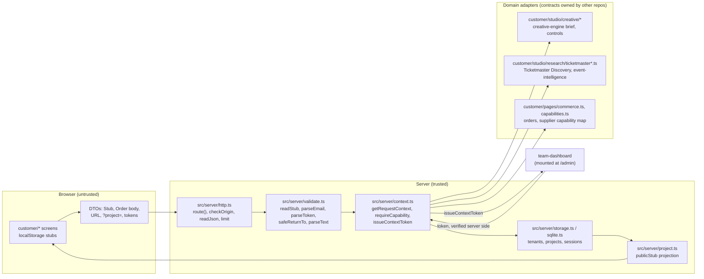

# Trust boundaries and types

GT-01 (#7). Three kinds of data meet in this app and they are never the same type: what the browser sends (untrusted), what the server derives about the caller (trusted), and what a domain adapter exchanges with another repo's contract (proposed, versioned elsewhere). A value only crosses from one to the next through a named function.

## 1. Untrusted: browser DTOs

Everything that arrives in a request is a claim, not a fact: bodies, query strings, URL tokens, cookies' contents, `Origin`, ids, roles, and "project" names. Types for these live with the screens that send them (`src/customer/studio/types.ts` `Stub`, `src/customer/pages/commerce.ts` `Order`, `src/customer/account/api.ts` client calls) and are **not** reused on the server as proof of anything.

Where they are checked:

- `src/server/http.ts`: the handler wrapper `route()` turns thrown `HttpError`s into the `{ error: { code, message } }` shape; `checkOrigin` refuses a mutating request from a foreign origin; `readJson` enforces a byte cap before parsing; `limit` rate-limits.
- `src/server/validate.ts`: the runtime validation. `readStub` (a stub body, size-capped), `parseEmail` / `parseAccountEmail`, `parseToken` (URL tokens), `safeReturnTo` (no open redirects), `parseText`. A route calls these before touching storage. TypeScript types alone prove nothing about request data.
- Other domain inputs get their own checks at the route: `src/app/api/research/route.ts` (URL allow-listing, demo mode refuses arbitrary URLs), `src/app/api/art/route.ts`, `src/app/api/orders/route.ts`.

## 2. Trusted: server-derived context

`src/server/context.ts` is the only place that answers "who is this, and what may they do". The `RequestContext` (`src/server/context-token.ts`) is derived from the httpOnly session cookie or the guest device cookie plus storage records, never from a body, query string or URL token. A route may name a project (`getRequestContext(req, { id, kind })`) and the answer is the caller's role on it; a project the caller cannot prove is theirs is role `none` and a 404, exactly as if it did not exist.

- Tenant: an account is a tenant; a guest is `guest:<id>` (drafts only). Stubs and organizer events are projects.
- Roles: `owner | captain | member | viewer | staff | none`; capabilities come from one matrix, `CAPABILITY_MATRIX`. Today the only organizer role is captain. Staff are accounts on `ADMIN_EMAILS` and hold only `admin.view`; they get no read access to anyone's projects.
- Enforcement: `requireCapability(ctx, cap)` throws a 404 (admin and invisible projects), 401 (not signed in) or 403.
- Downstream: `issueContextToken(ctx)` signs a versioned (`ticketstub.context/1`), five-minute copy for the dashboard and other consumers; `verifyContextToken` / `verifyContextTokenLive` check signature, version, expiry, and (live) revocation and membership revision.
- Outbound projection: `src/server/project.ts` (`publicStub`) removes guest lists, private notes, photos and account data from anything a link holder can read.

## 3. Domain adapter types

Each adapter converts between our `Stub`/`Order` types and a contract owned by another repo. The contract is a proposal there; the adapter is the single place our types touch it, and it is checked offline against that repo's fixtures.

| Adapter | Files | Contract owner | Check |
|---|---|---|---|
| Creative engine | `src/customer/studio/creative/` (`contracts.ts`, `controls.ts`, `adapter.ts`, `fixtures/`), `docs/integration/creative-engine.md` | creative-engine | `scripts/check-creative-adapter.mjs` (`verify:product --suite creative`) |
| Ticketmaster / event intelligence | `src/customer/studio/research/ticketmaster.ts`, `ticketmasterPackage.ts`, `docs/integration/event-intelligence.md` | event-intelligence | `scripts/smoke-ticketmaster.mjs` against `scripts/fixtures/ticketmaster-discovery-event.json` (`--suite research`) |
| Commerce and supplier capabilities | `src/customer/pages/commerce.ts`, `src/customer/pages/capabilities.ts`, `src/app/api/orders/route.ts` | print-production / fulfillment (supplier SKUs) | `--suite production` smoke (demo mode only) |
| Dashboard | `src/app/admin/contract.ts` (`ticketstub.admin-mount/1`) | team-dashboard | `--suite foundation` (admin fixture) |

Rules that follow from this:

1. A browser DTO is never passed to an adapter or to storage unvalidated, and an adapter type is never sent to the browser without a projection.
2. A decision about the caller is made from the context, once, at the route. Screens and the dashboard may hide things; they never grant anything.
3. In demo mode (`TICKETSTUB_RUNTIME_MODE` is not `live`) no adapter calls out: research uses fixtures, art is `simulated`, agent replies 204. `verify:product` runs with outbound network blocked to prove it.
4. No adapter invents ownership of work another repo does. Research, creative production, print production, fulfillment and the ledger are specified there; this app consumes them through these adapters.
