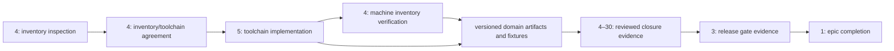

# Dependency handoff and evidence stages

[Requirements](requirements.json) retain all authoritative issue dependency edges. [Authority relationships](authority-dependencies.json) bind each public issue URL, original full-body hash and the exact blocked-by section. The checker compares dependency numbers and hashes as data, including Markdown links and the release gate's aggregate leaf list.

Issue #4 depends on SC-02/#5 for complete machine-validatable inventory verification. Inventory inspection and initial owner/toolchain agreement can proceed first. Issue #5 has no implementation-issue closure prerequisite in its authoritative body. Its local toolchain artifact follows initial inventory agreement; it does not require completed inventory verification or issue #4 closure.

The executable deliverable graph has separate artifact and closure-evidence nodes. Other leaves consume their declared implementation artifacts; they do not wait for blanket issue closure. Release issue #3 explicitly waits for accepted closure evidence from every leaf #4 through #30. Epic #1 follows the release gate and is not a prerequisite that would prevent that gate from starting.

scripts/dependency-map.mjs builds the graph from the recorded dependency data and detects missing nodes/cycles. docs:check validates it and rejects dropped or mismatched edges. Tests remove actual edges from a cloned requirements object and require failure; they do not pin prose phrasing. Every original body hash and acceptance ID remains preserved.

These stages describe work order and evidence obligations. Named owners, consumer pins, independent review, actual merged/source evidence and final release acceptance remain pending. No schema fixture or corrected dependency map closes an issue or verifies global acceptance.
