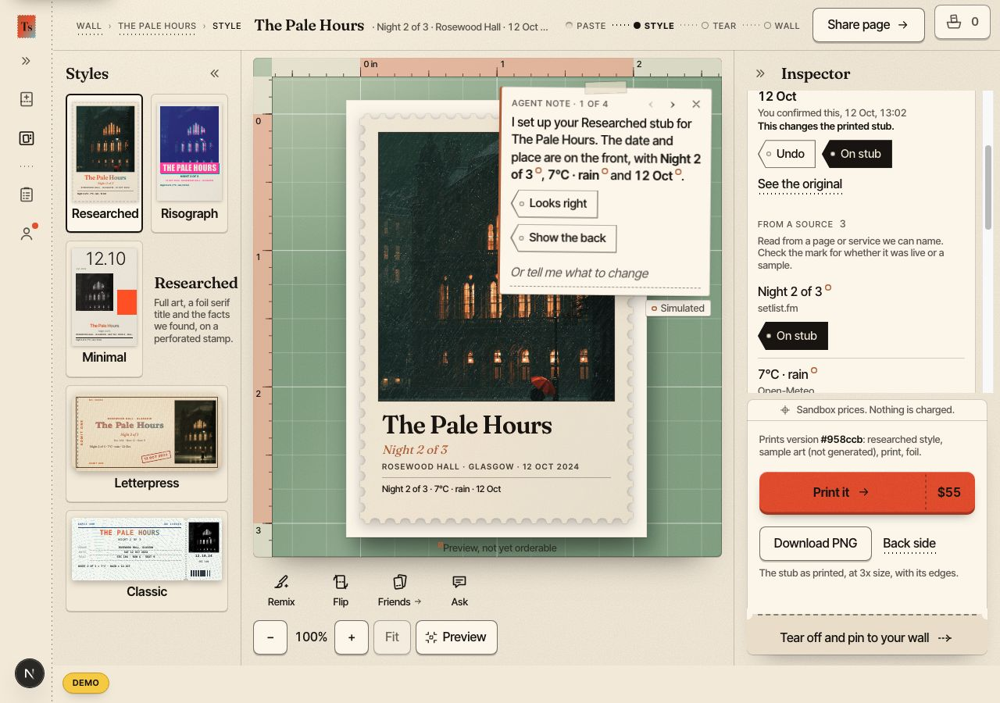

# Demo: recording still needed

[Back to TicketStub](../../README.md) · [Evidence](EVIDENCE.md) · [Submission steps](RULES-CHECKLIST.md)

**Final public demo: Missing. Placeholder available below.** The team supplied this video kit on October 12. It contains a **silent concept animatic**—a timed storyboard, not real product footage. Its measured length is **2:50.04** (170.04 seconds), with no audio track. It does not establish that the video requirement is complete.

**[Open/download the placeholder MP4](../assets/submission/ticketstub_judges_cut_animatic.mp4)** · **[Download the original video kit ZIP](../assets/submission/ticketstub_judges_cut_video_kit.zip)**

The ZIP is preserved as supplied. It includes editable frames, narration, draft subtitles, source notes, and an edit timeline. Screens inside the animatic are illustrations. Replace them with real app and tool footage. Its shot directions are production notes; the [official checklist](RULES-CHECKLIST.md) controls rule claims.

## Placeholder timeline and proposed final cut

The times below match the supplied storyboard. They are **not timestamps of verified product behavior**. Keep the final recording under three minutes.

| Time | Planned shot | What the recording must show |
| --- | --- | --- |
| 0:00–0:12 | Why keep a stub? | A clear product screen; explain the fan’s goal. |
| 0:12–0:30 | Add an event | Real input. Show the mode; call sample data “sample data.” |
| 0:30–0:54 | Agent at work | The actual steps and output. A live completion claim needs a retained complete live run. |
| 0:54–1:09 | Decisions and state | Explain what the app does. Do not imply every component is integrated. |
| 1:09–1:31 | neatlogs | Actual trace details. No speed or cost improvement claim without comparable runs. |
| 1:31–1:51 | Entire | Public code graph and exact source commit. Keep private transcripts off screen. |
| 1:51–2:10 | cfo.ai | Prices, costs, revenue, and runway. Say “These are forecasts, not sales.” Explain the export caveat. |
| 2:10–2:31 | Failure and next step | Show a recorded outcome. Recovery proof is still missing; do not invent it. |
| 2:31–2:43 | Public work | Public repos and genuine posts, if available. Draft posts do not count. |
| 2:43–2:50 | The keepsake | Actual downloaded result and evidence links. No physical delivery claim. |

## Recording assets still needed

- One final video with clear audio and captions, no longer than three minutes.
- A public playback URL or attached X video, tested while signed out.
- A retained complete live run if claiming live completion: input, source commit, trace identifiers, tool choices, checks, result, and any recovery.
- A neatlogs view tied to that same run; mask credentials and personal data.
- Tool footage for all three sponsors. Existing screenshots and graph files can support it; they do not create a live-demo claim.
- The final quote-post URL and official form confirmation.

## Replay the sample

In a fresh clone, use the versions in the [studio package file](../../repositories/getticketstub.com/package.json), then:

```sh
cd repositories/getticketstub.com
npm ci
TICKETSTUB_RUNTIME_MODE=demo npm run dev
```

Open the local address. Choose **The Pale Hours**. Confirm **12 Oct 2024** when asked. Choose **Download PNG**. You can also select **Tear off and pin to your wall**.

This fictional concert uses supplied facts, sample art, and rule-based replies. It does not fetch real event facts or spend model credits in demo mode. Do not set live mode or add provider keys for this replay.

**Observed October 12, 2026:** an isolated copy of studio commit [`6daafba1`](https://github.com/Jevelopers-neatHack-2026/getticketstub.com/commit/6daafba1a3384b20ad181b957fd5d5715da29153), with no credentials, loaded the sample. Confirming its date changed the stub. Download PNG produced the [actual sample output](../assets/submission/sample-stub-download.png). Chrome also displayed “Saved to your downloads.” This is a real app output made from fictional data.

The local preview used Node 24.15.0, npm 11.12.1, and Next.js 16.4.0. A fresh `npm ci --ignore-scripts --no-audit --no-fund` installed 348 packages in an isolated copy. No provider keys were supplied. The declared Node 22.23.3/npm 11.16.0 pair was not retested; use the project’s supported versions.

Download worked in the first `next dev --webpack` preview. That optional Webpack mode failed to compile the wall’s CSS selector. The normal `npm run dev` (Turbopack) then loaded the wall and displayed the saved Pale Hours stub. The [wall screenshot](../assets/submission/studio-demo-wall.jpg) and [390-pixel phone screenshot](../assets/submission/studio-demo-mobile.jpg) record that follow-up. No copied source was changed. This was a demo replay, not a production-build certification.


*Captured from the app, with its demo and simulated labels visible.*
