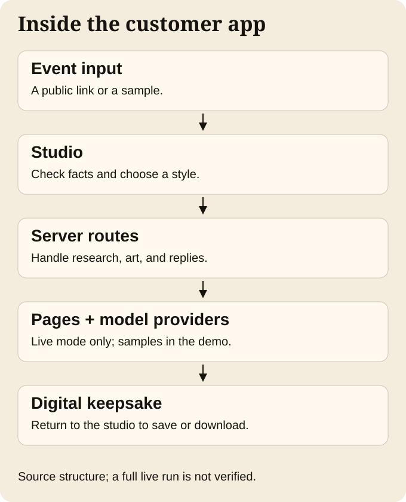
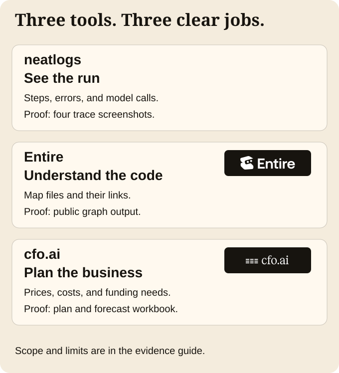

# Evidence a judge can check

[Back to TicketStub](../../README.md) · [Rules](RULES-CHECKLIST.md) · [Demo](DEMO.md)

**Reviewed October 12, 2026.** We distinguish a result seen in this pass, a retained artifact, an owner report, a sample, and a plan. “Owner-accepted” is an internal decision. It is not organizer approval.

## Follow the scorecard

| Weight | Judge’s question | Start here |
| --- | --- | --- |
| Agent · 30% | Can it finish a useful task? | [Sample output and live-evidence gap](#agent-task) |
| Required tools · 25% | How did the three tools help? | [neatlogs](#neatlogs), [Entire](#entire), [cfo.ai](#cfoai) |
| Demo · 20% | Can I see the work clearly? | [Placeholder and 2:50 plan](DEMO.md) |
| Building in public · 15% | What did the team share? | [Public build posts and code](#building-in-public) |
| Usefulness and originality · 10% | Why would someone want it? | A stub joins a night’s facts and art in one editable keepsake. [Real sample output](../assets/submission/sample-stub-download.png); no user-demand study or sales claim. |

Weights come from the [official rules](https://neatlogs.com/hackathon). This is a reading map, not a self-awarded score.

## Agent task

**Person and goal:** a fan wants a keepsake of a show, with details beyond a barcode. This is a use case, not a claim about a real customer.

**Observed sample:** The Pale Hours is fictional. In the local demo, choosing it loads a stub. The app supplies sample facts and art. The rule-based demo agent explains them. The user confirms an unsure date, chooses the details to keep, and downloads an image. We inspected the resulting PNG and confirmed the stub appeared on the local wall. This confirms the local path from supplied event to editable, downloadable keepsake. It does not show fresh research or live image generation.

- **Tested source:** [studio commit](https://github.com/Jevelopers-neatHack-2026/getticketstub.com/commit/6daafba1a3384b20ad181b957fd5d5715da29153), [fixture definition](https://github.com/Jevelopers-neatHack-2026/getticketstub.com/blob/6daafba1a3384b20ad181b957fd5d5715da29153/src/customer/studio/fixtures.ts), and [demo agent rules](https://github.com/Jevelopers-neatHack-2026/getticketstub.com/blob/6daafba1a3384b20ad181b957fd5d5715da29153/src/customer/studio/agent/planner.ts).
- **Result:** [downloaded PNG](../assets/submission/sample-stub-download.png), [desktop screen](../assets/submission/studio-demo-desktop.jpg), [wall](../assets/submission/studio-demo-wall.jpg), [phone view](../assets/submission/studio-demo-mobile.jpg), and [replay notes](DEMO.md#replay-the-sample).
- **Live design in code:** event-page research, art generation, and agent routes exist. Providers require live configuration. [Runtime routing](https://github.com/Jevelopers-neatHack-2026/getticketstub.com/blob/6daafba1a3384b20ad181b957fd5d5715da29153/src/server/ai/providers.ts) and [research route](https://github.com/Jevelopers-neatHack-2026/getticketstub.com/blob/6daafba1a3384b20ad181b957fd5d5715da29153/src/app/api/research/route.ts) describe that behavior; reading code alone does not prove a successful run.
- **Missing proof:** one retained live input-to-output run that joins the goal, changing agent decisions, tool calls, checks, any recovery, exact deployed revision, and final artifact. The four neatlogs screens below are separate partial records.

<picture>
  <source media="(prefers-color-scheme: dark)" srcset="../assets/submission/system-dark.svg">
  
</picture>

*This is the customer app’s implemented route structure, not a claim that every component repo is wired into one live release.*

In words: the studio sends work to the app’s server routes. Live research may read a public event page; configured model providers can supply facts, art, or replies. The studio displays the result and supports a download or saved wall. The local demo substitutes sample facts, sample art, and rule-based replies. The separate agent-harness, event-intelligence, and creative-engine packages have their own work and tests; full cross-repo integration remains unproven here.

## Required tools

<picture>
  <source media="(prefers-color-scheme: dark)" srcset="../assets/submission/tools-dark.svg">
  
</picture>

*These are documented tool roles; the diagram does not certify complete live integration.*

### neatlogs

**Artifact verified:** four public screenshots show research success, a research timeout, an agent reply, and an art workflow. A trace means a record of a run’s steps. The art screen labels two model steps `openai/gpt-image-2`; this is the October 11 record, not a claim about the latest image model.

[Research success screenshot](../../repositories/integration-evals/evidence/neatlogs/2026-10-11/trace-research-success.jpg) · [Art screenshot](../../repositories/integration-evals/evidence/neatlogs/2026-10-11/trace-art-image.jpg) · [Full dated record](https://raw.githubusercontent.com/Jevelopers-neatHack-2026/integration-evals/89141b4e9237d7cc1548254b99dbd0f01589eaa4/evidence/neatlogs/2026-10-11/README.md)

The record names studio producer `e4a19931b5febbf6efdb85e11d1d3da1b88106fe`. That binding is **owner-reported**, not shown in the screenshots. Trace IDs, deployment identity, and exact timestamps are not visibly joined to the images. The malformed-art recovery is summary-only. Billing, delivery of all reported sessions, and comparable before/after improvement remain unverified. No new live run was made for this guide.

### Entire

**Artifact verified:** public `entire-graph` output maps source code at studio commit `c384776771eaa6b64beba99607007b5b9d47066d`. The snapshot header names that revision and the retained checksum file matches all four files when rerun in this pass.

[Graph evidence and source revision](https://raw.githubusercontent.com/Jevelopers-neatHack-2026/integration-evals/89141b4e9237d7cc1548254b99dbd0f01589eaa4/evidence/entire/2026-10-11/graph-getticketstub-c384776/README.md) · [Original GitHub Actions run](https://github.com/Jevelopers-neatHack-2026/getticketstub.com/actions/runs/38166575087)

This graph was made on GitHub Actions without an agent session. It proves graph output, not agent improvement. The broader record reports one Claude checkpoint and later synced mirrors; the hosted Sessions view did not show a transcript. Checkpoint contents remain private and were not copied or inspected here. The record’s later caveat says plugin installation was unpinned; a displayed version is not a reproducible dependency lock.

### cfo.ai

**Artifact verified:** revision 2 includes a saved plan, screenshot, and exported workbook. They cover prices, costs, revenue, and runway—the time before money runs out.

**[Read the business plan (text)](https://raw.githubusercontent.com/Jevelopers-neatHack-2026/integration-evals/89141b4e9237d7cc1548254b99dbd0f01589eaa4/evidence/cfo-ai/2026-10-11-r2/cfo-canvas-narrative.md)** · **[Download the reviewer workbook](https://raw.githubusercontent.com/Jevelopers-neatHack-2026/integration-evals/89141b4e9237d7cc1548254b99dbd0f01589eaa4/evidence/cfo-ai/2026-10-11-r2/cfo-native-export.xlsx)** · [Canvas screenshot](../../repositories/integration-evals/evidence/cfo-ai/2026-10-11-r2/cfo-canvas-overview.jpg) · [Full qualification record](https://raw.githubusercontent.com/Jevelopers-neatHack-2026/integration-evals/89141b4e9237d7cc1548254b99dbd0f01589eaa4/evidence/cfo-ai/2026-10-11-r2/README.md)

The plan’s numbers are **forecasts, not sales**. Actual cash is unknown; owner-reported expenses are not reconciled bills. Physical sales are excluded. The record reports desktop Excel checks; this pass rechecked the file hashes, not those spreadsheet calculations.

**Original October 11 export:** [Download the original business-plan workbook](https://raw.githubusercontent.com/Jevelopers-neatHack-2026/integration-evals/89141b4e9237d7cc1548254b99dbd0f01589eaa4/evidence/cfo-ai/2026-10-11/cfo-native-export.xlsx). This is byte-for-byte identical to the team-supplied `TicketStub — neatHack Business Plan — 2026-10-11.xlsx` download. It was already included in the source collection. The main workbook link above points to revision 2, a different, later reviewer file. Keep the original as history; use revision 2 with the qualifications below for judging.

The reviewer workbook has four blank-safe formula corrections made through the CFO.ai assistant. The unchanged generic export still has a blank-cash problem in two scenarios. The dated folder says owner acceptance was pending; the later master index records owner acceptance of SPN-03. Preserve both in order: that acceptance does not approve the unresolved generic export issue, CFO-R2-001. The cfo.ai workspace needs login; the linked public files do not.

## Building in public

**Verified build posts:** [Day 1 · October 10](https://x.com/CompleteTechLLC/status/2109089580159004778) introduces TicketStub. [Day 2 · October 11](https://x.com/CompleteTechLLC/status/2109407386289189284) shares the product and a stream link. Both use #neatHack and name @neatlogs, @EntireHQ, and @arithecfo. We opened each exact post in Chrome on October 12. Their URLs also returned HTTP 200 without authentication. Full signed-out X rendering was not separately checked.

The posts prove public updates, not every product claim in their copy. Day 1’s printing language is not proof of physical fulfillment. Day 2’s usage and cost figures are owner reports, not audited metrics. We did not verify the linked stream or its recordings and do not count them as the final demo.

**Timothy's usage report:** Timothy Wayne Gregg (`completedottech`) supplied a later October 12 report covering his local coding-agent usage. It records 28.32 billion tokens and 209,429 usage records; 97.19% of tokens were cached reads. Its $8,503.11 figure is an API-price estimate, not actual spend. Attribution to Timothy is owner-provided; these are not team-wide totals. [Read the short summary and original PDF](USAGE.md), including scope, counter mismatches, and pricing limits. It does not prove a completed live product task or independently audit the Day 2 post.

**Crystal's usage ledger:** the team supplied pasted ledger text and the credit **Crystal (lajefa)**. It reports 128,391,680 tokens and 1,137 calls across May 19–October 12, including pre-event work. [Read the attributed summary](CRYSTAL-USAGE.md). The $87.11 API-price estimate and $80 subscription claim are not audited spending. No original file, raw logs, or bills were provided. These figures are kept separate from Timothy's; no combined team total is claimed.

**Zach's usage report:** the team attributes an 11-page PDF to **Zach (zwright)**. It reports **3,859,621,041 tokens** across **16,189 calls**, from October 10–12 through 2:31:50 p.m. Eastern. Its totals match his earlier pasted table. [Read the PDF, estimated value, and limits](ZACH-USAGE.md). The original logs were not supplied; identity and event eligibility remain unverified. This is a separate owner report, not a team-wide total.

Timothy's [searchable report and complete CSV bundle](USAGE.md#explore-the-report) are now retained with the PDF. The event CSV and all 34 partition tables reconcile internally. That does not verify original log capture, actual charges, or overlap with other team members' reports.

The [source repositories](../../REPOSITORIES.md), [telemetry implementation PR](https://github.com/Jevelopers-neatHack-2026/getticketstub.com/pull/46), and [Entire graph Actions run](https://github.com/Jevelopers-neatHack-2026/getticketstub.com/actions/runs/38166575087) also expose work and discussion.

**Still missing:** a verified final demo quote-post of the official launch post. The two build posts predate that launch and do not satisfy this step. The [marketing copy](../../repositories/marketing-material/launch/announcement-copy.md) remains a draft. No engagement or customer-demand score is claimed here.

## Code history

[Repository, file, line, and source-commit counts](../../REPOSITORIES.md#collection-at-a-glance) describe the pinned collection. [Counting rules](COLLECTION.md) separate source history from submission snapshots and explain included tests, generated code, and pre-event history.

[Source provenance](SOURCE-PROVENANCE.json) records the inspected original commits, GitHub account attribution, and author/committer dates. All 14 inspected source tips are dated October 12. Original histories remain in those public repositories; the submission repository records snapshots.

Examples: [studio commit](https://github.com/Jevelopers-neatHack-2026/getticketstub.com/commit/6daafba1a3384b20ad181b957fd5d5715da29153), [integration-evals commit](https://github.com/Jevelopers-neatHack-2026/integration-evals/commit/89141b4e9237d7cc1548254b99dbd0f01589eaa4). Every current snapshot also has an exact source commit and tree in [sources.json](../../sources.json).

**Eligibility still needs review.** A tip dated in the event does not prove all code was first written in the allowed period. The older architecture report describes pre-event planning. We did not audit every ancestor or ask organizers about asset eligibility. Dates were not changed. Discord controls the final cutoff. Presentation updates and later syncs may postdate the event window; they do not establish eligibility of new code.

## Limits that matter

- Complete live agent task, measured improvement, final video, required public post, and form confirmation remain open.
- The sample is simulated. It is not a paid customer result or proof that physical products can be ordered.
- Wall navigation failed in an initial Webpack preview on a CSS selector. The normal Turbopack development server then showed the saved stub on its wall. Download succeeded. See [replay notes](DEMO.md#replay-the-sample) for the exact runtime and any later verification.
- Evidence files describe the revisions they tested. A source refresh does not refresh the evidence or close internal acceptance gates.
