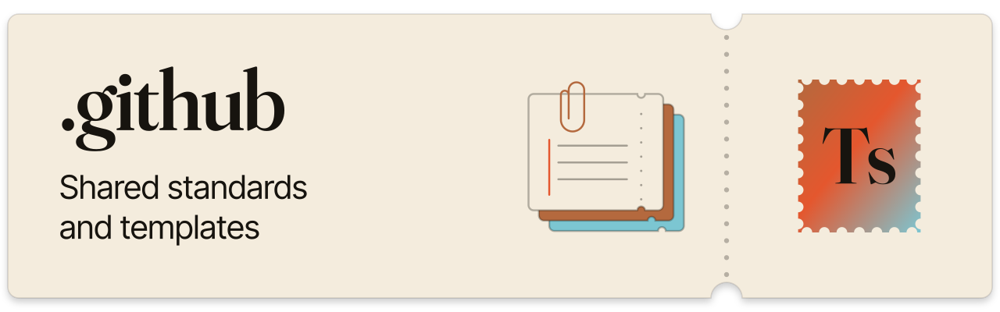

<a href="https://github.com/Jevelopers-neatHack-2026/.github">
  <picture>
    <source media="(prefers-color-scheme: dark)" srcset="docs/assets/readme/banner-night.svg">
    
  </picture>
</a>

# .github

Shared contribution standards, governance records, contributor templates and reusable workflow starters for the Jevelopers neatHack 2026 repositories.

<p>
  <a href="https://github.com/Jevelopers-neatHack-2026"></a>
  <a href="#status"></a>
  <a href="templates/README.md"></a>
</p>

[Status](#status) · [Start here](#start-here) · [Checks](#checks) · [Docs](#docs) · [Related repositories](#related-repositories) · [Contributing](#contributing)

These documents define expectations. They do not change repository settings, prove that a product requirement passed, or establish adoption by another repository.

## Status

The maintainer accepted the **reduced repository-guidance scope** on 2026-10-12 at immutable revision [2f61f85](https://github.com/Jevelopers-neatHack-2026/.github/commit/2f61f8551ecf38170f0c5b225305c950c7c3b222). The [dated gate decision](https://github.com/Jevelopers-neatHack-2026/.github/issues/16#issuecomment-6122141536) records the accepted scope, exact source, validation and remaining limitations. Recheck live issues before relying on this snapshot.

- **Leaf issues:** all ten retained leaves are closed completed: #4, #5, #6, #7, #8, #9, #10, #12, #14 and #15. The [GH-08 acceptance receipt](https://github.com/Jevelopers-neatHack-2026/.github/issues/5#issuecomment-6122075793) records actual maintainer acceptance of the unchanged PR #24 guidance and its integration-evals compatibility review. It is distinct from an agent review or a GitHub approval.
- **Reduced scope:** at the user's direction, [#11](https://github.com/Jevelopers-neatHack-2026/.github/issues/11) (security reporting) and [#13](https://github.com/Jevelopers-neatHack-2026/.github/issues/13) (sixth form and private routing) were closed **not planned**, with possible later addition. See the scope addenda on [#16](https://github.com/Jevelopers-neatHack-2026/.github/issues/16#issuecomment-6116512227) and [#3](https://github.com/Jevelopers-neatHack-2026/.github/issues/3#issuecomment-6116512413). This is deferred scope, not a passed check: the original twelve-leaf security baseline is not complete, no private reporting route is confirmed, and only five active issue forms exist. Do not send sensitive details through a public issue.
- **Gate and epic:** [#16](https://github.com/Jevelopers-neatHack-2026/.github/issues/16) (`GH-11`) and [#3](https://github.com/Jevelopers-neatHack-2026/.github/issues/3) are closed for the same reduced scope; the [epic closure receipt](https://github.com/Jevelopers-neatHack-2026/.github/issues/3#issuecomment-6122142963) preserves the exclusions. Earlier pending-acceptance assessments remain historical.
- **Published sources:** the pull-request template (`GH-PR-TEMPLATE@1.0.0`) and five active issue forms (`GH-ISSUE-FORMS@1.0.0`) were published by [PR #19](https://github.com/Jevelopers-neatHack-2026/.github/pull/19) and [PR #20](https://github.com/Jevelopers-neatHack-2026/.github/pull/20).
- **Workflow sources:** `.github/workflows/docs-check.yml` provides a reusable Markdown link check. `.github/workflows/governance-checks.yml` calls it and runs the offline governance validator and fixture tests for pull requests targeting `main`, pushes to `main`, and manual dispatch. These files define source behavior; their presence does not by itself prove a successful hosted run, required-check configuration, or consumer adoption.
- **Limits:** a local validator or fixture result shows only what its command exercised. It does not establish a GitHub-hosted run's outcome, reusable-workflow access, token/fork/secret isolation, required-check enforcement, or consumer adoption. For hosted execution, link the exact PR and run and record caller/source revisions and inspected results; substantiate settings and adoption separately. Local issue-form validation does not render GitHub's native UI; document UI behavior with a dated preview for the relevant form version. Master acceptance, product release, and private security routing require their own authoritative evidence.
- **Acceptance:** master acceptance IDs and their status are owned by [integration-evals](https://github.com/Jevelopers-neatHack-2026/integration-evals). A merged documentation change, local fixture result or mock check does not verify one.

**Organization adoption audit (2026-10-12):** the [human-readable governance and profile status addendum](adoption/observations/governance-status-addendum-2026-10-12.md) and [machine-readable organization adoption observations](adoption/observations/organization-adoption-2026-10-12.json) record the public-tree snapshot at 17:16:34 UTC and a separate repository metadata/settings observation at 17:19:49 UTC. They describe only those recorded revisions and times, not later repository state.

**Historical snapshot, superseded where it differs:** at public revision [4129e71](https://github.com/Jevelopers-neatHack-2026/.github/commit/4129e71f42a51d42803b1020e146f54108cf2f93) (observed 2026-10-11 02:48:39 UTC) `GH-03-I` (#13) and `GH-07` (#11) were open and blocked, and `GH-01` and `GH-04` were still awaiting acceptance. The scope change above supersedes that open/blocked state; the snapshot is kept as dated evidence.

**Dated references:** [status and boundaries](docs/status.md), the [governance gap register](adoption/governance-register.json), and the [governance release assessment](adoption/governance-release-record.md) are dated records. The register and release assessment remain historical snapshots; consult the adoption addendum and observation JSON for the dated organization audit, and recheck live evidence before acting.

## Start here

| You want to | Read |
|---|---|
| Open a pull request | [Contribution guidance](CONTRIBUTING.md), [branch-to-review procedure](standards/contribution-workflow.md), [pull-request template](.github/pull_request_template.md) |
| File an issue | [Issue-form source and adoption guidance](templates/issue-forms.md) |
| Work as a coding agent | [AGENTS.md](AGENTS.md) and [agent guidance](standards/agent-contributors.md) |
| Record evidence | [Acceptance and evidence rules](standards/acceptance-evidence.md) and the [evidence record](templates/evidence-record.md) |
| Adopt guidance in a repository | [Bootstrap checklist](adoption/repository-bootstrap.md) and [adoption record](templates/adoption-record.md) |
| Bootstrap, maintain, hand off or retire governance | [Governance lifecycle](standards/governance-lifecycle.md) |
| Review the organization adoption audit | [Status addendum](adoption/observations/governance-status-addendum-2026-10-12.md) and [exact observations](adoption/observations/organization-adoption-2026-10-12.json) |

## Checks

The root caller in `.github/workflows/governance-checks.yml` invokes the reusable `.github/workflows/docs-check.yml` with repository-wide Markdown scope and runs the local governance validator and offline fixture suite on pull requests to `main`, pushes to `main`, and manual dispatch. The workflow files are source configuration. Their presence does not establish a hosted result or required-check enforcement; verify each claim against the exact PR, Actions run, source/caller revisions, and settings evidence.

From the repository root, use Python 3.10 or newer and Node on `PATH` to create a virtual environment and install the pinned test dependency. Dependency installation may download the package; it is setup, not an offline check.

```sh
python3 -m venv .venv
.venv/bin/python -m pip install --no-input -r automation-design/tests/requirements.txt
.venv/bin/python scripts/validate_governance.py
.venv/bin/python -m unittest discover -s automation-design/tests -v
```

The validator checks the documented repository-specific subset of issue forms, workflow files, records, links, and related governance sources. The test suite exercises the checker and security-surface fixtures offline. Neither command renders issue forms in GitHub, checks live label availability, verifies destination settings, or supplies a hosted Actions result. See the [validator limits and supported rules](automation-design/reusable-workflows.md#offline-governance-validator) and the [local fixture](automation-design/fixtures/reusable-workflow/README.md).

## Docs

| Area | Documents |
|---|---|
| Status and gates | [2026-10-12 governance status addendum](adoption/observations/governance-status-addendum-2026-10-12.md) · [Earlier status and boundaries (dated)](docs/status.md) · [Earlier governance release assessment (dated)](adoption/governance-release-record.md) |
| Inventory | [2026-10-12 organization adoption observations](adoption/observations/organization-adoption-2026-10-12.json) · [Governance inventory](adoption/governance-inventory.md) · [Historical governance gap register (dated)](adoption/governance-register.json) |
| Standards | [Governance lifecycle](standards/governance-lifecycle.md) · [Acceptance and evidence](standards/acceptance-evidence.md) · [Architecture linking](standards/architecture-linking.md) · [Releases and versioning](standards/releases-versioning.md) · [Label planning](standards/labels-planning.md) · [Security and secret handling](standards/security-secret-handling.md) |
| Templates | [Contributor templates](templates/README.md) · [Issue forms](templates/issue-forms.md) · [Release record](templates/release-record.md) · [Backlog audit](templates/backlog-audit.md) |
| Workflows | [Reusable workflow design](automation-design/reusable-workflows.md) · [Examples](automation-design/examples/README.md) · [Workflow starter](workflow-templates/docs-check.yml) |
| Security | [Pending security policy draft](community/SECURITY.pending.md) |
| Ownership | [Local ownership view](docs/architecture/OWNERSHIP.md) · [Local acceptance view](docs/architecture/ACCEPTANCE.md) |
| Organization profile | [profile/README.md](profile/README.md) |

## Repository structure

| Path | Responsibility |
|---|---|
| [`profile/`](profile/) | Organization entry point and its existing TicketStub artwork |
| [`.github/`](.github/) | Published pull-request template and five active issue forms |
| [`.github/workflows/`](.github/workflows/) | Reusable Markdown link check and this repository's governance-validation caller |
| [`standards/`](standards/) | Contribution, evidence, architecture, release and security guidance |
| [`templates/`](templates/) | Reusable documentation contracts and worked examples |
| [`adoption/`](adoption/) | Bootstrap instructions and dated rollout observations |
| [`automation-design/`](automation-design/) | Reviewed workflow sources, synthetic fixtures and local tests |
| [`workflow-templates/`](workflow-templates/) | Starter files for deliberate adoption in destination repositories |

No product runtime, environment file or deployment command is required to use this documentation. Installing a workflow in another repository and configuring its permissions remain that repository's work.

## Related repositories

- [getticketstub.com](https://github.com/Jevelopers-neatHack-2026/getticketstub.com): canonical architecture and the [implementation plan](https://github.com/Jevelopers-neatHack-2026/getticketstub.com/blob/main/docs/planning/implementation-plan.md).
- [shared-contracts](https://github.com/Jevelopers-neatHack-2026/shared-contracts): canonical schemas and the [contract catalog](https://github.com/Jevelopers-neatHack-2026/shared-contracts/blob/main/docs/contract-catalog.md).
- [integration-evals](https://github.com/Jevelopers-neatHack-2026/integration-evals): master [acceptance checklist](https://github.com/Jevelopers-neatHack-2026/integration-evals/blob/main/planning/acceptance-checklist.md) and evidence records.

Each repository owns its local instructions, checks, settings and adoption record.

## Contributing

Follow [CONTRIBUTING.md](CONTRIBUTING.md) and, for agents, [AGENTS.md](AGENTS.md). Use neutral `Refs #N` links, record the commands you actually ran, and keep credentials and customer data out of every artifact. Agent instructions, CODEOWNERS, licenses, workflow callers, labels and settings are local decisions in each repository; no license file is included here.
