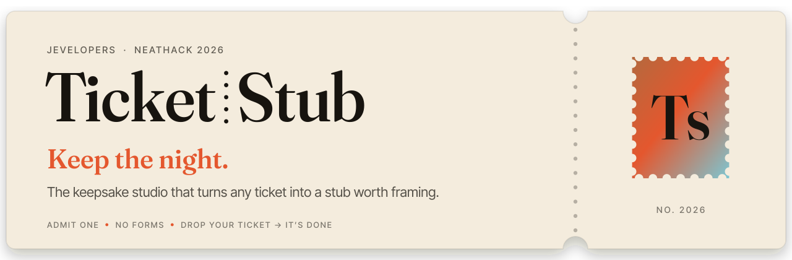
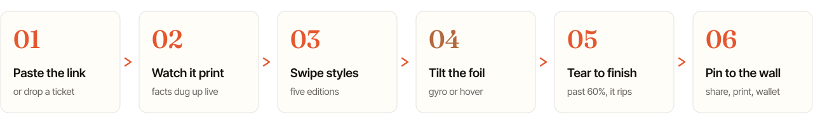
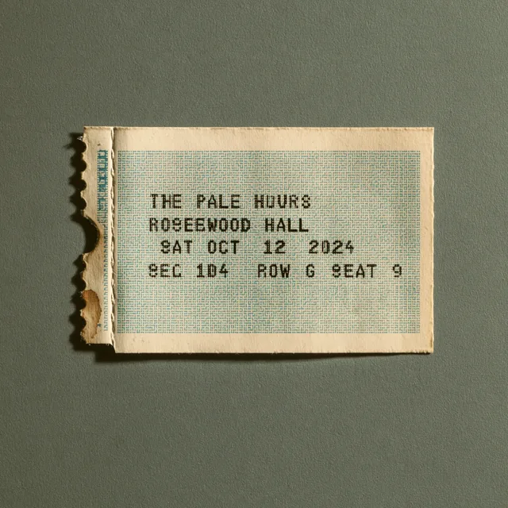
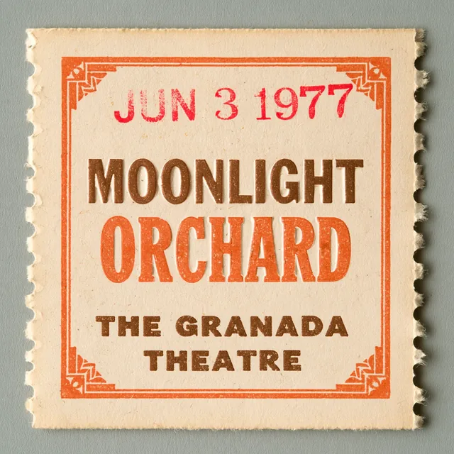
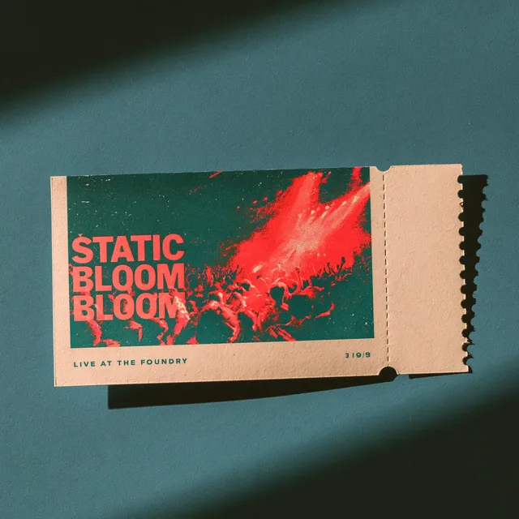
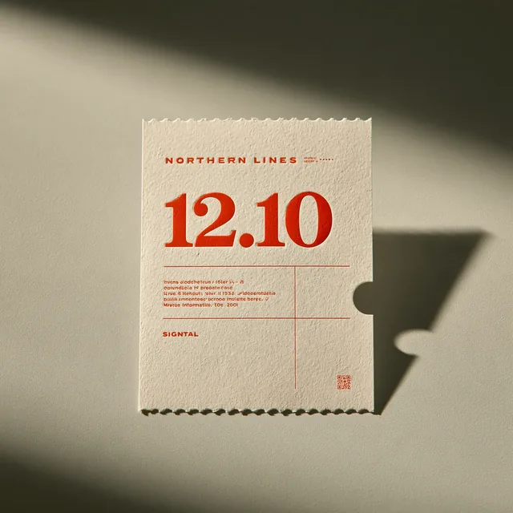
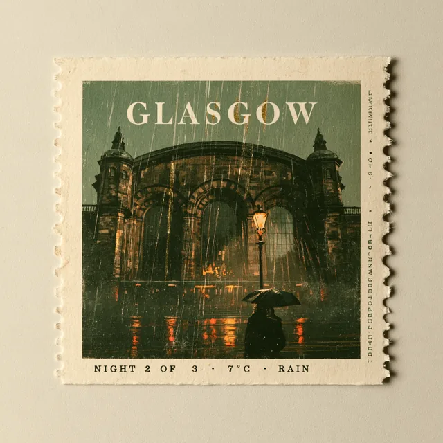
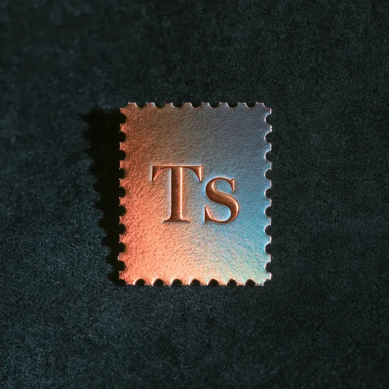
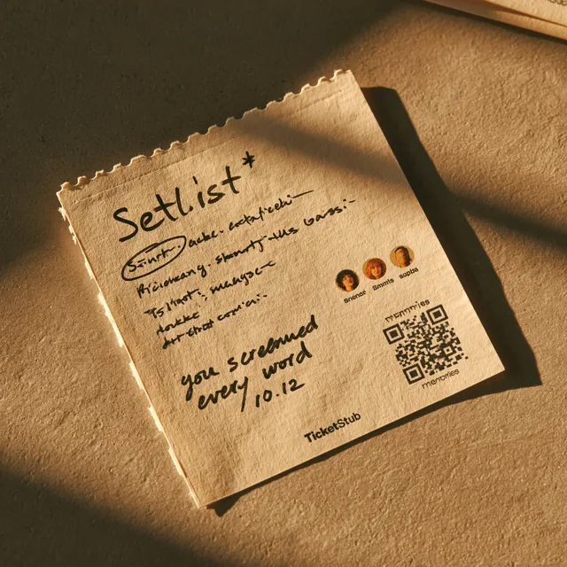
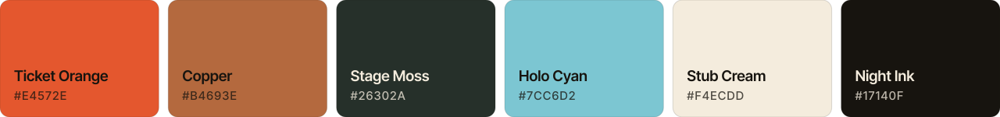

<a href="https://github.com/Jevelopers-neatHack-2026/getticketstub.com">
  <picture>
    <source media="(prefers-color-scheme: dark)" srcset="./assets/banner-night.svg">
    
  </picture>
</a>

  
  
  
  

**Jevelopers** is the neatHack 2026 team building **TicketStub**, a keepsake studio for the nights people want to remember. The product vision connects event research, editable artwork, exact ticket typography and a digital or printed keepsake.

> Keep the night: turn a ticket into a stub worth framing.

**Development status — 12 October 2026:** the studio preview and component implementations are on their owning repositories' default branches. Local tests and historical sponsor receipts cover specific slices; the [integrated release gate](https://github.com/Jevelopers-neatHack-2026/integration-evals/issues/22) remains blocked. This page introduces the design and repository map. It does not certify an available physical product, a completed checkout or a passing end-to-end release.

[Explore the studio source](https://github.com/Jevelopers-neatHack-2026/getticketstub.com) · [Download the public source collection](https://github.com/Jevelopers-neatHack-2026/Jevelopers-GetTicketStub.com-Submission) · [Acceptance checklist](https://github.com/Jevelopers-neatHack-2026/integration-evals/blob/main/planning/acceptance-checklist.md) · [Contribute](https://github.com/Jevelopers-neatHack-2026/.github/blob/main/CONTRIBUTING.md)

## Studio design

<picture>
  <source media="(prefers-color-scheme: dark)" srcset="./assets/flow-night.svg">
  
</picture>

The design starts with an event link or search, then offers research, style selection and tactile interactions. The illustration shows that intended journey. Research and creative outputs must retain source references, uncertainty and review boundaries; the [studio documentation](https://github.com/Jevelopers-neatHack-2026/getticketstub.com/tree/main/docs/studio) and component READMEs explain the implemented paths and their remaining integration work.

## Five editions

The studio design includes five editions. These images are design references, and each edition has its own palette and type within the [stub system](https://github.com/Jevelopers-neatHack-2026/getticketstub.com/blob/main/docs/studio/stub-system.md). They are not supplier samples or evidence of available print finishes.

<table>
  <tr>
    <td align="center" width="20%"> <b>Classic</b> thermal box office</td>
    <td align="center" width="20%"> <b>Letterpress</b> inked and pressed</td>
    <td align="center" width="20%"> <b>Risograph</b> two inks, overprinted</td>
    <td align="center" width="20%"> <b>Minimal</b> one number, lots of air</td>
    <td align="center" width="20%"> <b>Researched</b> art made from the facts</td>
  </tr>
</table>

<table>
  <tr>
    <td width="34%"></td>
    <td>
      <b>Research informs the picture.</b> This Glasgow illustration shows how a confirmed fact, such as rain, can guide an art brief. It is an example, not a verified event record.  
      The imagery guidance calls for a text-free art layer, with event names and dates set separately by the composition system. Generated output still needs review; a prompt does not guarantee accuracy.  
      Rules: <a href="https://github.com/Jevelopers-neatHack-2026/brand-kit/blob/main/docs/imagery.md">imagery.md</a>
    </td>
  </tr>
</table>

## Material and interaction references

<table>
  <tr>
    <td align="center" width="33%"> <b>Foil reference</b>: a visual direction for light-responsive digital effects</td>
    <td align="center" width="33%"> <b>Holo reference</b>: material inspiration, not an approved supplier option</td>
    <td align="center" width="33%"> <b>Back-of-stub concept</b>: notes, companions and a link to the memory</td>
  </tr>
</table>

The current brand sources describe paper and foil treatments, with app-versus-marketing direction still under [brand review](https://github.com/Jevelopers-neatHack-2026/brand-kit/issues/9). Browser support, reduced-motion behavior, audio settings and physical production capabilities belong to their implementation owners. Consult the [application README](https://github.com/Jevelopers-neatHack-2026/getticketstub.com#readme) for current pricing modes and checkout configuration; these reference images make no price, shipping or print-availability promise.

## The repositories

The public directory below was checked on 12 October 2026. Repository READMEs are the entry points for setup and current limitations; a source repository's existence does not establish an accepted deployment or integration.

### Product and presentation

| Repository | Owns | Current scope |
|---|---|---|
| [getticketstub.com](https://github.com/Jevelopers-neatHack-2026/getticketstub.com) | Customer studio, project and order authorization, application integration, architecture | Preview application and verification tooling; consult its runtime and provider configuration |
| [brand-kit](https://github.com/Jevelopers-neatHack-2026/brand-kit) | Master identity, logo sources, tokens and usage guidance | Source assets and local checks; identity and distribution approvals remain pending |
| [landing-page-repo](https://github.com/Jevelopers-neatHack-2026/landing-page-repo) | Product-page source and its reviewable deployment artifact | Static page and local validation; application adoption and deployment evidence are separate |
| [marketing-material](https://github.com/Jevelopers-neatHack-2026/marketing-material) | Messaging, collateral, demo narrative and claim provenance | Versioned internal drafts and review records; publication needs its own approval |
| [team-dashboard](https://github.com/Jevelopers-neatHack-2026/team-dashboard) | Typed admin Finance views and application-facing UI adapter | React module and synthetic conformance evidence; actual host acceptance remains separate |

### Runtime services

| Repository | Owns | Current scope |
|---|---|---|
| [agent-harness](https://github.com/Jevelopers-neatHack-2026/agent-harness) | Durable workflows, decision ports, checkpoints, recovery and trace delivery | Local runtime and scoped provider evidence; host and full-workflow readiness tracked separately |
| [event-intelligence](https://github.com/Jevelopers-neatHack-2026/event-intelligence) | Event research, sourced facts, provenance and research cache | Bounded research implementation and local verification |
| [creative-engine](https://github.com/Jevelopers-neatHack-2026/creative-engine) | Creative briefs, generated artwork and immutable design revisions | Creative API and local validation; configured providers and consumer acceptance have separate gates |
| [print-production](https://github.com/Jevelopers-neatHack-2026/print-production) | Exact typography, composition, preflight and production artifacts | Local renderer and production API candidates; supplier and integrated release acceptance pending |
| [fulfillment-connectors](https://github.com/Jevelopers-neatHack-2026/fulfillment-connectors) | Provider quotes, submission identities and status observations | Connector and policy implementation; genuine provider authorization and evidence remain gated |
| [cost-intelligence](https://github.com/Jevelopers-neatHack-2026/cost-intelligence) | Usage, prices, budgets, ledger, reconciliation and financial reporting | Local Finance implementation; source pins, hosted persistence and consumer evidence govern integration |

### Contracts, verification and shared guidance

| Repository | Owns | Current scope |
|---|---|---|
| [shared-contracts](https://github.com/Jevelopers-neatHack-2026/shared-contracts) | Cross-repository contract design and compatibility ownership | Offline receipt and proposal validators on `main`; the canonical package candidates remain unmerged |
| [integration-evals](https://github.com/Jevelopers-neatHack-2026/integration-evals) | Master acceptance checklist, evaluation runners and evidence index | Executable checks and scoped historical sponsor evidence; full release gate remains blocked |
| [.github](https://github.com/Jevelopers-neatHack-2026/.github) | This profile, contribution guidance and shared templates | Reduced governance-guidance scope accepted; repository settings and downstream adoption remain separate |

### Source collection

[Jevelopers-GetTicketStub.com-Submission](https://github.com/Jevelopers-neatHack-2026/Jevelopers-GetTicketStub.com-Submission) collects public default-branch source snapshots for convenient review. Its manifest records the exact source commits. Develop components in their owning repositories; the generated copies are a snapshot, not a new integrated build or a product acceptance receipt.

### How the pieces connect

The application owns the customer project and purchase authorization. The runtime repositories provide workflow execution, event facts, artwork, production files and provider observations; cost-intelligence owns the financial records, and team-dashboard presents authorized projections. Shared-contracts owns the interface design and compatibility handoffs, while integration-evals owns the acceptance decision.

Use the [canonical architecture guide](https://github.com/Jevelopers-neatHack-2026/getticketstub.com/blob/main/docs/architecture-kit/v1.0/docs/architecture.md), [maintained contract catalog](https://github.com/Jevelopers-neatHack-2026/shared-contracts/blob/main/docs/contract-catalog.md) and [implementation plan](https://github.com/Jevelopers-neatHack-2026/getticketstub.com/blob/main/docs/planning/implementation-plan.md) for the detailed map. Proposed interfaces, private development archives and accepted releases are different states; each consumer records its own exact pin and verification.

## Team

<table>
  <tr>
    <td align="center" width="25%"><a href="https://github.com/CompleteDotTech"> <b>Timothy Wayne Gregg</b></a> @CompleteDotTech</td>
    <td align="center" width="25%"><a href="https://github.com/lmvdz"> <b>Lars van der Zande</b></a> @lmvdz</td>
    <td align="center" width="25%"><a href="https://github.com/zwright8"> <b>Zachary Wright</b></a> @zwright8</td>
    <td align="center" width="25%"><a href="https://github.com/lajefahemp-collab"> <b>@lajefahemp-collab</b></a> &nbsp;</td>
  </tr>
</table>

## Built for neatHack 2026

TicketStub is our project for [neatHack 2026](https://neatlogs.com/hackathon). The [master acceptance checklist](https://github.com/Jevelopers-neatHack-2026/integration-evals/blob/main/planning/acceptance-checklist.md) records qualified historical owner acceptance for the three sponsor criteria: Neatlogs traces, Entire checkpoints and the CFO.ai business plan. Each receipt retains its tested revision, original capture context and limitations.

Those sponsor receipts do not establish a fresh integrated product run, universal trace coverage, current deployment, generic Finance-export acceptance or a completed submission. The [evidence index](https://github.com/Jevelopers-neatHack-2026/integration-evals/blob/main/evidence/README.md) and [release gate](https://github.com/Jevelopers-neatHack-2026/integration-evals/issues/22) carry those distinctions.

Want to help, or to review? Start with the [contribution guidance](https://github.com/Jevelopers-neatHack-2026/.github/blob/main/CONTRIBUTING.md) and the [acceptance checklist](https://github.com/Jevelopers-neatHack-2026/integration-evals/blob/main/planning/acceptance-checklist.md).

   
  Brand, editions and studio design by <a href="https://github.com/lmvdz">@lmvdz</a> 
  Reference images are AI-generated explorations, with no vendor, artist or venue marks 
  Type: Fraunces and Inter Tight (SIL OFL 1.1)

