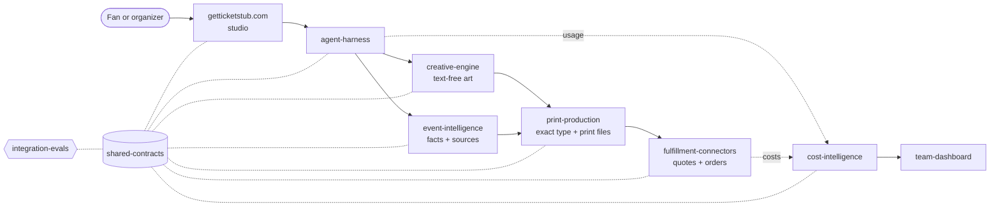

<a href="https://github.com/Jevelopers-neatHack-2026/getticketstub.com">
  <picture>
    <source media="(prefers-color-scheme: dark)" srcset="./assets/banner-night.svg">
    
  </picture>
</a>

  
  
  
  

**Jevelopers** is the neatHack 2026 team building **TicketStub**: paste the link to a show, a game or a night out, and get back a collectible stub with the facts of that night set in type, art made for it, and foil that catches the light. Then tear it off, pin it to your wall, or print it and frame it.

> For people who want to keep the night, TicketStub is the keepsake studio that turns any ticket into a stub worth framing. No forms: drop your ticket and it's done.

## How it works

<picture>
  <source media="(prefers-color-scheme: dark)" srcset="./assets/flow-night.svg">
  
</picture>

The only thing you ever type is a link or a search. A research agent digs up the night while the stub prints (the weather, which night of the tour, who opened) and every fact shows where it came from. Everything after that is tap, swipe, tilt and tear.

## Five editions

Every stub can be dealt in five styles. The editions are the user's artwork, so each has its own palette and type; only the Ts stamp and the foil come from our brand.

<table>
  <tr>
    <td align="center" width="20%"> <b>Classic</b> thermal box office</td>
    <td align="center" width="20%"> <b>Letterpress</b> inked and pressed</td>
    <td align="center" width="20%"> <b>Risograph</b> two inks, overprinted</td>
    <td align="center" width="20%"> <b>Minimal</b> one number, lots of air</td>
    <td align="center" width="20%"> <b>Researched</b> art made from the facts</td>
  </tr>
</table>

<table>
  <tr>
    <td width="34%"></td>
    <td>
      <b>Research becomes the picture.</b> If it rained in Glasgow on night 2 of 3, the art shows rain in Glasgow, and the negative prompt rules out snow.  
      The art never contains text: our type engine sets every letter, so names and dates are always exact. Every scene is muted except for one orange accent, which keeps every generated stub related to the others.  
      Rules: <a href="https://github.com/Jevelopers-neatHack-2026/brand-kit/blob/main/docs/imagery.md">imagery.md</a>
    </td>
  </tr>
</table>

## Made to be handled

<table>
  <tr>
    <td align="center" width="33%"> <b>Foil</b> that follows the light: gyro on phones, hover on desktop</td>
    <td align="center" width="33%"> <b>Holo stock</b> and spot holo as print upgrades</td>
    <td align="center" width="33%"> <b>The back</b>: setlist or score, a note, who you were with, a QR to the memory page</td>
  </tr>
</table>

Paper by day, foil by night. Sound is on by default (with a mute toggle you can always see), haptics mark every tear, and the foil is eased frame by frame so it never pops in. Digital $9 · Card $29 · Print $49 · Framed $89, all sandbox prices for the hackathon.

## The repositories

Fourteen repositories, each with one job. Status reflects what is on `main` on 11 October 2026, not what is planned.

| | Repository | Job | Status |
|:-:|---|---|---|
| 🎟️ | [**getticketstub.com**](https://github.com/Jevelopers-neatHack-2026/getticketstub.com) | The studio app, wall, memory pages and checkout; architecture kit |  |
| 🎨 | [**brand-kit**](https://github.com/Jevelopers-neatHack-2026/brand-kit) | Logo system, tokens, voice, motion, foil rules |  |
| 🧭 | [**agent-harness**](https://github.com/Jevelopers-neatHack-2026/agent-harness) | Durable agent workflows, checkpoints and recovery |  |
| 🔎 | [**event-intelligence**](https://github.com/Jevelopers-neatHack-2026/event-intelligence) | Sourced event facts, provenance and research cache |  |
| 🖌️ | [**creative-engine**](https://github.com/Jevelopers-neatHack-2026/creative-engine) | Creative briefs, artwork versions and revisions |  |
| 📐 | [**shared-contracts**](https://github.com/Jevelopers-neatHack-2026/shared-contracts) | Public schemas, validators and compatibility fixtures |  |
| 🖨️ | [**print-production**](https://github.com/Jevelopers-neatHack-2026/print-production) | Exact type, templates and print-ready files |  |
| 📦 | [**fulfillment-connectors**](https://github.com/Jevelopers-neatHack-2026/fulfillment-connectors) | Supplier quotes, orders and status |  |
| 💰 | [**cost-intelligence**](https://github.com/Jevelopers-neatHack-2026/cost-intelligence) | Pricing, metering, budgets, ledger and finance exports |  |
| 📊 | [**team-dashboard**](https://github.com/Jevelopers-neatHack-2026/team-dashboard) | The finance admin module inside the studio |  |
| ✅ | [**integration-evals**](https://github.com/Jevelopers-neatHack-2026/integration-evals) | End-to-end checks, acceptance checklist and evidence |  |
| 🪧 | [**landing-page-repo**](https://github.com/Jevelopers-neatHack-2026/landing-page-repo) | The public product page |  |
| 📣 | [**marketing-material**](https://github.com/Jevelopers-neatHack-2026/marketing-material) | Demo narrative, launch copy and claim provenance |  |
| 🧰 | [**.github**](https://github.com/Jevelopers-neatHack-2026/.github) | This page, contribution guidance and shared standards |  |

**Local foundation:** built and tested inside its own repository; integration with the other pieces and acceptance are still open. **Docs baseline:** plans and ownership only on `main` (shared-contracts and integration-evals have implementation work in draft pull requests). **Drafts:** a synthetic rehearsal and collateral, not approved for publication. The studio preview is a hackathon prototype, with more work in review.

<b>How the pieces connect</b>

 

Every arrow crosses a contract defined in [`shared-contracts`](https://github.com/Jevelopers-neatHack-2026/shared-contracts). The full picture is in the [architecture guide](https://github.com/Jevelopers-neatHack-2026/getticketstub.com/blob/main/docs/architecture-kit/v1.0/docs/architecture.md) and the [implementation plan](https://github.com/Jevelopers-neatHack-2026/getticketstub.com/blob/main/docs/planning/implementation-plan.md).

## Team

<table>
  <tr>
    <td align="center" width="25%"><a href="https://github.com/CompleteDotTech"> <b>Timothy Wayne Gregg</b></a> @CompleteDotTech</td>
    <td align="center" width="25%"><a href="https://github.com/lmvdz"> <b>Lars van der Zande</b></a> @lmvdz</td>
    <td align="center" width="25%"><a href="https://github.com/zwright8"> <b>Zachary Wright</b></a> @zwright8</td>
    <td align="center" width="25%"><a href="https://github.com/lajefahemp-collab"> <b>@lajefahemp-collab</b></a> &nbsp;</td>
  </tr>
</table>

## Built for neatHack 2026

TicketStub is our entry for [neatHack 2026](https://neatlogs.com/hackathon). The rules ask for a substantial agent task, public code with event-dated commits, and real use of three sponsor tools: **Neatlogs** for agent traces, **Entire** for checkpoints, and **CFO.ai** for the business plan. None of those integrations is accepted yet. `agent-harness` maps its trace records through the Neatlogs SDK locally, but no trace has reached Neatlogs; a CFO.ai business plan is in review in [integration-evals #24](https://github.com/Jevelopers-neatHack-2026/integration-evals/pull/24). We'll record each one in [`integration-evals`](https://github.com/Jevelopers-neatHack-2026/integration-evals) as the evidence comes in.

Want to help, or to review? Start with the [contribution guidance](https://github.com/Jevelopers-neatHack-2026/.github/blob/main/CONTRIBUTING.md) and the [acceptance checklist](https://github.com/Jevelopers-neatHack-2026/integration-evals/blob/main/planning/acceptance-checklist.md).

   
  Brand, editions and studio design by <a href="https://github.com/lmvdz">@lmvdz</a> 
  Reference images are AI-generated explorations, with no vendor, artist or venue marks 
  Type: Fraunces and Inter Tight (SIL OFL 1.1)

